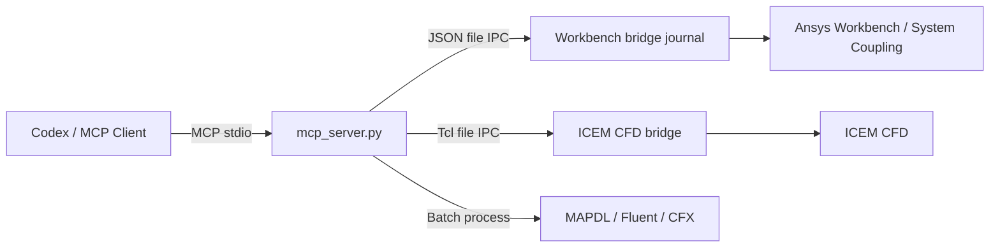

# Ansys Workbench MCP

<div align="center">

**English** | [简体中文](README.md) | [繁體中文](README.zh-TW.md) | [한국어](README.ko.md) | [日本語](README.ja.md)

</div>


Control **Ansys Workbench** directly from Codex or another MCP client.

The project uses officially supported Ansys entry points—journals, Workbench scripting, Tcl/Replay, and batch execution—without relying on mouse clicks or screen recognition.

> [!NOTE]
> This is not an official Ansys product. It currently targets Windows and has been tested on a physical installation of Ansys 2025 R1.

## Capabilities

| Module | Capabilities |
| --- | --- |
| Workbench | Start and stop the bridge, execute scripts, inspect/open/save/update projects, and create analysis systems |
| ICEM CFD | Start GUI or batch sessions, execute Tcl/Replay, discover commands, and run Replay files |
| Mechanical / MAPDL | Create thermal, structural, and dynamic systems; run APDL input files directly |
| Fluent | Run journals/TUI directly; create a Workbench system when a compatible template is installed |
| CFX | Create Workbench CFX systems and run `.def` files directly |
| System Coupling / FSI | Create CFX–Transient Structural two-way FSI projects, connect participants, configure transfers and solver controls, then run or export them |

Supported Workbench systems include Steady-State Thermal, Transient Thermal, Static Structural, Transient Structural, Modal, Harmonic Response, Response Spectrum, Random Vibration, CFX, System Coupling, and any available Fluent templates.

## How it works



Workbench and ICEM commands, results, and logs are written to runtime directories. These directories are created automatically and excluded by `.gitignore`.

## Quick start

### 1. Install

```powershell
cd D:\
git clone https://github.com/hongwenwang36-eng/ANSYS-Workbench-mcp.git ansys-workbench-mcp
cd D:\ansys-workbench-mcp
py -3.13 -m venv .venv
.\.venv\Scripts\python.exe -m pip install -r requirements.txt
```

If Python 3.13 is not installed, run `py -0p` to list installed versions and replace the version number above.

### 2. Configure Codex

Add the following to `%USERPROFILE%\.codex\config.toml`:

```toml
[mcp_servers.ansys-workbench]
command = 'D:\ansys-workbench-mcp\.venv\Scripts\python.exe'
args = ['D:\ansys-workbench-mcp\mcp_server.py']
cwd = 'D:\ansys-workbench-mcp'
startup_timeout_sec = 30
tool_timeout_sec = 600
enabled = true

[mcp_servers.ansys-workbench.env]
ANSYS_WORKBENCH_MCP_HOME = 'D:\ansys-workbench-mcp'
ANSYS_RUNWB2 = 'D:\Program Files\ANSYS Inc\v251\Framework\bin\Win64\RunWB2.exe'
ANSYS_MECHANICAL = 'D:\Program Files\ANSYS Inc\v251\aisol\bin\winx64\AnsysWBU.exe'
ANSYS_MAPDL = 'D:\Program Files\ANSYS Inc\v251\ansys\bin\winx64\ANSYS251.exe'
ANSYS_FLUENT = 'D:\Program Files\ANSYS Inc\v251\fluent\ntbin\win64\fluent.exe'
ANSYS_CFX_SOLVE = 'D:\Program Files\ANSYS Inc\v251\CFX\bin\cfx5solve.exe'
ANSYS_CFX_PRE = 'D:\Program Files\ANSYS Inc\v251\CFX\bin\cfx5pre.exe'
ANSYS_ICEM_CFD = 'D:\Program Files\ANSYS Inc\v251\icemcfd\win64_amd\bin\icemcfd.bat'
```

Adjust the environment variables if Ansys is installed elsewhere. Restart Codex after saving the configuration.

### 3. Check the connection

Call these tools in Codex:

```text
check_ansys_installation
start_workbench_bridge
check_workbench_connection
```

After the connection succeeds, Codex can create systems, execute scripts, and operate on projects.

## Common operations

### Workbench

```text
# Create a Steady-State Thermal system
create_steady_state_thermal_system_live(
  project_dir="D:/ansys-projects",
  project_name="thermal_case"
)

# Create a CFX system
create_cfx_flow_system_live(
  project_dir="D:/ansys-projects",
  project_name="cfx_case"
)

# Inspect and save the current project
get_project_info
save_project
```

For one-off tasks that do not require a persistent bridge, use `run_workbench_journal`, `create_workbench_analysis_system`, or `create_and_run_thermal_bar_demo`.

### CFX–Mechanical two-way FSI

```text
# 1. Create three systems and connect both participants
create_cfx_mechanical_fsi_project_live(
  project_dir="D:/ansys-projects/fsi",
  project_name="cfx_mechanical_fsi"
)

# 2. Complete meshing, transient physics, and coupling boundaries in CFX
#    and Mechanical, then refresh Setup
# 3. Query the participant, region, and variable names actually published
get_system_coupling_status_live

# 4. Configure coupling time step and iteration limits
configure_system_coupling_settings_live(
  step_size="0.001 [s]",
  end_time="0.1 [s]",
  minimum_iterations=1,
  maximum_iterations=10
)

# 5. Use the exact names returned above to create both transfers
configure_cfx_mechanical_two_way_fsi_live(...)

# 6. Validate, then solve
run_system_coupling_solution_live
```

Two-way FSI contains two transfers: Mechanical displacement → CFX mesh displacement, and CFX fluid force → Mechanical load. The project-creation tool does not invent meshes, materials, boundaries, or interface regions; the actual model must supply those physical inputs.

### ICEM CFD

```text
# Start a headless session
start_icem_bridge(batch=true)

# Inspect the session and Blocking commands
get_icem_session_info
list_icem_commands(pattern="ic_hex_*", limit=300)

# Execute Tcl/Replay
execute_icem_script(script="ic_load_tetin {D:/cases/model.tin}")

# Run a Replay file once
run_icem_replay(
  replay_file="D:/cases/mesh.rpl",
  workdir="D:/cases"
)
```

For reliable parameterized execution, record commands with ICEM Replay Control first and then pass them to MCP.

### Direct solver invocation

```text
run_mapdl_input(input_file="D:/cases/model.dat")
run_fluent_journal(journal_path="D:/cases/run.jou")
run_cfx_solver(definition_file="D:/cases/model.def")
```

## MCP tools

<details>
<summary>Show all 46 tools</summary>

| Tool | Description |
| --- | --- |
| `check_ansys_installation` | Check Ansys executable and bridge paths |
| `check_icem_installation` | Check ICEM CFD and the Tcl bridge |
| `start_icem_bridge` | Start a persistent ICEM CFD session |
| `stop_icem_bridge` | Stop the persistent ICEM CFD session |
| `check_icem_connection` | Check the ICEM bridge connection |
| `execute_icem_script` | Execute Tcl/Replay in ICEM |
| `get_icem_session_info` | Inspect the ICEM session |
| `list_icem_commands` | Discover ICEM Tcl commands |
| `run_icem_replay` | Run a Replay file in batch mode |
| `start_workbench_bridge` | Start the Workbench bridge |
| `stop_workbench_bridge` | Stop the Workbench bridge |
| `check_workbench_connection` | Check the Workbench connection |
| `execute_workbench_script` | Execute a script in Workbench |
| `get_project_info` | Get information about the current project |
| `open_project` | Open a `.wbpj` project |
| `save_project` | Save the current project |
| `update_project` | Update the current project |
| `probe_workbench_analysis_templates_live` | Discover available analysis templates |
| `probe_system_coupling_live` | Inspect the System Coupling template and scripting interface |
| `create_cfx_mechanical_fsi_project_live` | Create and connect a CFX–Mechanical–System Coupling project |
| `connect_system_coupling_participants_live` | Connect existing systems as coupling participants |
| `get_system_coupling_status_live` | Inspect participants, regions, variables, transfers, and settings |
| `configure_system_coupling_settings_live` | Configure coupling step size, duration, and iteration controls |
| `create_system_coupling_data_transfer_live` | Create a generic data transfer |
| `configure_cfx_mechanical_two_way_fsi_live` | Create the displacement and force transfers for two-way FSI |
| `export_system_coupling_setup_live` | Export a System Coupling `.sci` setup |
| `run_system_coupling_solution_live` | Update and run the coupled Solution |
| `create_workbench_analysis_system_live` | Create a generic analysis system |
| `create_steady_state_thermal_system_live` | Create a Steady-State Thermal system |
| `create_transient_thermal_system_live` | Create a Transient Thermal system |
| `create_static_structural_system_live` | Create a Static Structural system |
| `create_transient_structural_system_live` | Create a Transient Structural system |
| `create_modal_analysis_system_live` | Create a Modal system |
| `create_harmonic_response_system_live` | Create a Harmonic Response system |
| `create_response_spectrum_system_live` | Create a Response Spectrum system |
| `create_random_vibration_system_live` | Create a Random Vibration system |
| `create_cfx_flow_system_live` | Create a CFX system |
| `create_fluent_flow_system_live` | Attempt to create a Fluent system |
| `create_thermal_bar_demo_live` | Create and solve the thermal-bar demo |
| `run_workbench_journal` | Run a Workbench journal in batch mode |
| `create_workbench_analysis_system` | Create an analysis system in batch mode |
| `create_steady_state_thermal_system` | Create a Steady-State Thermal system in batch mode |
| `run_mapdl_input` | Run a MAPDL input file |
| `run_fluent_journal` | Run a Fluent journal |
| `run_cfx_solver` | Run a CFX `.def` file |
| `create_and_run_thermal_bar_demo` | Run the thermal-analysis demo in batch mode |

</details>

## MCP resources

| URI | Content |
| --- | --- |
| `ansys-workbench://status` | Workbench bridge status |
| `ansys-workbench://installation` | Ansys installation-path check |
| `ansys-workbench://icem/status` | ICEM CFD bridge status |

## Validation status

The following items have been verified on a physical Ansys 2025 R1 installation:

- Registration of 46 MCP tools and 3 resources
- Workbench bridge lifecycle, script execution, and project inspection/open/save/update
- Creation of Steady-State Thermal, Transient Thermal, Static Structural, Transient Structural, Modal, Harmonic Response, Response Spectrum, Random Vibration, and CFX systems
- System Coupling templates, CFX/Transient Structural participant connections, and saving a three-system FSI project
- Workbench and MAPDL thermal solves: 525 nodes, 20–100 °C, and 0 MAPDL errors
- Headless Fluent `3ddp` journal execution
- ICEM CFD bridge, Tcl/Replay, command discovery, and batch mode

Current limitations:

- No common Fluent template was found in the tested Workbench installation; `run_fluent_journal` has been verified instead.
- The path and invocation logic of `run_cfx_solver` have been checked, but a complete solve still requires a valid user-provided `.def` file.
- Two-way transfers and coupled solves require real CFX/Mechanical meshes, System Coupling regions, and variables. An empty project validates only the system topology, not a physical case.

## Troubleshooting

| Problem | Resolution |
| --- | --- |
| Codex cannot see the tools | Check the paths in `config.toml` and restart Codex |
| Ansys path does not exist | Update the corresponding `ANSYS_*` environment variable |
| Workbench bridge times out | Run `stop_workbench_bridge`, start it again, and inspect `mcp.log` |
| ICEM bridge times out | Start with `start_icem_bridge(batch=true)` and inspect `icem/icem_bridge.log` |
| Fluent template is unavailable | Use `run_fluent_journal` or specify an installed template with `template_name` |

## Development and testing

```powershell
.\.venv\Scripts\python.exe -m unittest discover -s tests -v
```

The tests validate the README, all 46 registered tools, all 3 resources, bridge-version alignment, and ICEM IPC behavior.

## License

[MIT](LICENSE)
