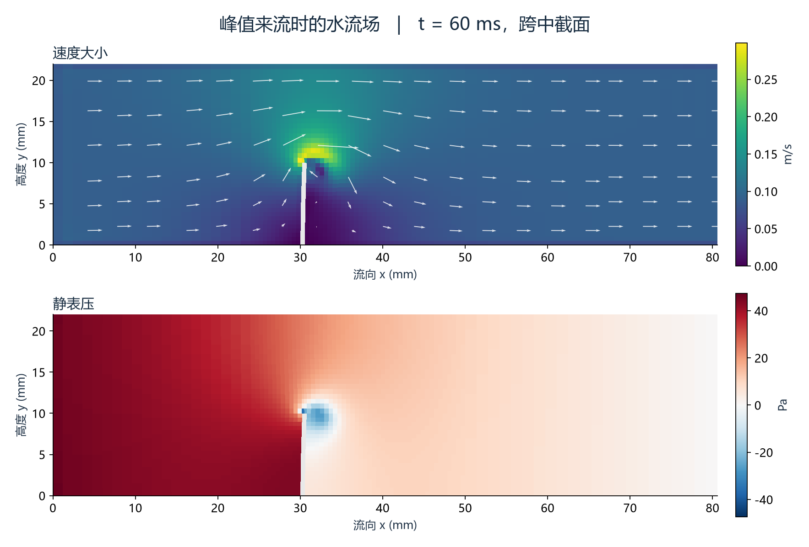
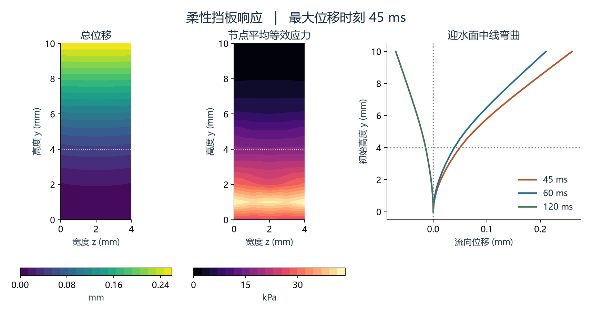
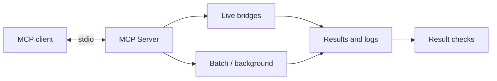

# Ansys Workbench MCP

<div align="center">

**English** | [简体中文](README.md) | [繁體中文](README.zh-TW.md) | [한국어](README.ko.md) | [日本語](README.ja.md)

</div>


Control **SpaceClaim, Ansys Workbench, Ansys Meshing, System Coupling, ICEM CFD, MAPDL, Fluent, CFX-Pre, CFX Solver, and CFD-Post** directly from Codex or another MCP client.

The project uses officially supported Ansys entry points—journals, Workbench scripting, Tcl/Replay, and batch execution—without relying on mouse clicks or screen recognition.

> [!NOTE]
> This is not an official Ansys product. It currently targets Windows and has been tested on a physical installation of Ansys 2025 R1.

## Supported simulations

| Simulation | Solver | Verified scope |
| --- | --- | --- |
| Static and nonlinear structural | Mechanical APDL | Linear statics, frictionless contact, and bilinear plasticity |
| Structural dynamics | Mechanical APDL | Modal, prestressed modal, harmonic response, transient, response spectrum, and random vibration |
| Thermal | Mechanical, Mechanical APDL | Steady conduction and transient heating |
| Thermal–structural coupling | Mechanical APDL | Transfer a temperature field to the structural model and compute thermal expansion |
| Fluid flow | Fluent, CFX | Duct flow, static mixing, and cavitation |
| Conjugate heat transfer | Fluent | Fluid and solid temperature fields with an interface heat-flow check |
| Two-way fluid–structure interaction | System Coupling, Fluent, Mechanical APDL | Exchange fluid forces and structural displacements. The CFX–Mechanical Workbench route was verified at the system topology level |

## Validated example · Two-way FSI with Fluent

Pulsating water flow passes a flexible cantilever baffle made of two materials. Fluent computes the fluid load, and System Coupling transfers it to Mechanical APDL and feeds the structural displacement back to Fluent's dynamic mesh.

- The channel measures 80.6 × 22 × 4 mm. The baffle is 10 mm high and 0.6 mm thick. The inlet velocity rises from zero to 0.09 m/s and returns to zero over 0.12 s.
- All 24 time steps converged, with 100% interface area mapping coverage in both directions. The maximum total displacement was 0.259 mm and the maximum node-averaged equivalent stress was 43.7 kPa, both at 45 ms.
- At 60 ms, the maximum flow speed on the midspan section was 0.299 m/s. The run used one mesh and a fixed time step size. Mesh and time-step independence have yet to be assessed.

**Water velocity and static gauge pressure at 60 ms**



**Baffle displacement and equivalent stress at 45 ms**



## How it works

Codex or another MCP client calls the local Python server over standard input and output (stdio). The server uses a persistent bridge or runs a batch tool, then returns status, a log excerpt, or file paths over MCP.



- **Persistent bridges.** Workbench receives commands through JSON files in the active project session, where it can create analysis systems, update the project, and configure System Coupling. The ICEM CFD bridge runs scripts in the active session using Tcl command files. Both bridges return JSON responses.
- **Batch tools.** The server passes journals, scripts, or solver input files to Ansys programs. It supports SpaceClaim geometry, standalone Ansys Meshing, ICEM Replay, MAPDL, Fluent, CFX, CFD-Post, and standalone System Coupling. A two-way FSI run can use standalone System Coupling to exchange fluid forces and structural displacements between Fluent and MAPDL.
- **Background jobs.** Submit a long batch run with `start_ansys_job`. Use the job ID with `get_ansys_job` to retrieve status and logs after reconnecting, or with `stop_ansys_job` to cancel the local job.
- **Result checks.** Use `diagnose_ansys_log` to locate errors in solver logs and `verify_simulation` to check CSV metrics against limits in matching units. The server creates default runtime directories such as `commands/`, `results/`, `icem/`, and `runs/` as needed. Git ignores those directories.

## Quick start

### 1. Install

```powershell
cd D:\
git clone https://github.com/hongwenwang36-eng/ANSYS-Workbench-mcp.git ansys-workbench-mcp
cd D:\ansys-workbench-mcp
py -3.13 -m venv .venv
.\.venv\Scripts\python.exe -m pip install -r requirements.txt
```

If Python 3.13 is not installed, run `py -0p` to list installed versions and replace the version number above.

### 2. Configure Codex

Add the following to `%USERPROFILE%\.codex\config.toml`:

```toml
[mcp_servers.ansys-workbench]
command = 'D:\ansys-workbench-mcp\.venv\Scripts\python.exe'
args = ['D:\ansys-workbench-mcp\mcp_server.py']
cwd = 'D:\ansys-workbench-mcp'
startup_timeout_sec = 30
tool_timeout_sec = 600
enabled = true

[mcp_servers.ansys-workbench.env]
ANSYS_WORKBENCH_MCP_HOME = 'D:\ansys-workbench-mcp'
ANSYS_RUNWB2 = 'D:\Program Files\ANSYS Inc\v251\Framework\bin\Win64\RunWB2.exe'
ANSYS_MECHANICAL = 'D:\Program Files\ANSYS Inc\v251\aisol\bin\winx64\AnsysWBU.exe'
ANSYS_MAPDL = 'D:\Program Files\ANSYS Inc\v251\ansys\bin\winx64\ANSYS251.exe'
ANSYS_FLUENT = 'D:\Program Files\ANSYS Inc\v251\fluent\ntbin\win64\fluent.exe'
ANSYS_SPACECLAIM = 'D:\Program Files\ANSYS Inc\v251\scdm\SpaceClaim.exe'
ANSYS_CFX_SOLVE = 'D:\Program Files\ANSYS Inc\v251\CFX\bin\cfx5solve.exe'
ANSYS_CFX_PRE = 'D:\Program Files\ANSYS Inc\v251\CFX\bin\cfx5pre.exe'
ANSYS_CFX_POST = 'D:\Program Files\ANSYS Inc\v251\CFX\bin\cfx5post.exe'
ANSYS_ICEM_CFD = 'D:\Program Files\ANSYS Inc\v251\icemcfd\win64_amd\bin\icemcfd.bat'
ANSYS_SYSTEM_COUPLING = 'D:\Program Files\ANSYS Inc\v251\SystemCoupling\bin\systemcoupling.bat'
```

Adjust the environment variables if Ansys is installed elsewhere. Restart Codex after saving the configuration.

### 3. Check the connection

Call `check_ansys_installation` to check the executable paths. Start and check the bridge when working with the current Workbench project.

```text
start_workbench_bridge
check_workbench_connection
```

Standalone Ansys Meshing and solver batch tools can run directly.

## Skills and examples

The 12 project skills cover workflows, geometry, meshing, structural and dynamic analysis, thermal analysis, CFD, coupling, parameter studies, diagnosis, verification, and postprocessing. [Skill catalog and examples](docs/skills-and-validation.md)

[Full validation record](docs/validation-record.md) · [Ansys Meshing and ICEM examples](examples/meshing/README.md)

## MCP tools

<details>
<summary>Show all 57 tools</summary>

| Tool | Description |
| --- | --- |
| `check_ansys_installation` | Check Ansys executable and bridge paths |
| `write_ansys_script` | Safely write a supported Ansys script file; overwrite is disabled by default |
| `check_icem_installation` | Check ICEM CFD and the Tcl bridge |
| `start_icem_bridge` | Start a persistent ICEM CFD session |
| `stop_icem_bridge` | Stop the persistent ICEM CFD session |
| `check_icem_connection` | Check the ICEM bridge connection |
| `execute_icem_script` | Execute Tcl/Replay in ICEM |
| `get_icem_session_info` | Inspect the ICEM session |
| `list_icem_commands` | Discover ICEM Tcl commands |
| `run_icem_replay` | Run a Replay file in batch mode |
| `start_workbench_bridge` | Start the Workbench bridge |
| `stop_workbench_bridge` | Stop the Workbench bridge |
| `check_workbench_connection` | Check the Workbench connection |
| `execute_workbench_script` | Execute a script in Workbench |
| `get_project_info` | Get information about the current project |
| `open_project` | Open a `.wbpj` project |
| `save_project` | Save the current project |
| `update_project` | Update the current project |
| `probe_workbench_analysis_templates_live` | Discover available analysis templates |
| `probe_system_coupling_live` | Inspect the System Coupling template and scripting interface |
| `create_cfx_mechanical_fsi_project_live` | Create and connect a CFX–Mechanical–System Coupling project |
| `connect_system_coupling_participants_live` | Connect existing systems as coupling participants |
| `get_system_coupling_status_live` | Inspect participants, regions, variables, transfers, and settings |
| `configure_system_coupling_settings_live` | Configure coupling step size, duration, and iteration controls |
| `create_system_coupling_data_transfer_live` | Create a generic data transfer |
| `configure_cfx_mechanical_two_way_fsi_live` | Create the displacement and force transfers for two-way FSI |
| `export_system_coupling_setup_live` | Export a System Coupling `.sci` setup |
| `run_system_coupling_solution_live` | Update and run the coupled Solution |
| `create_workbench_analysis_system_live` | Create a generic analysis system |
| `create_steady_state_thermal_system_live` | Create a Steady-State Thermal system |
| `create_transient_thermal_system_live` | Create a Transient Thermal system |
| `create_static_structural_system_live` | Create a Static Structural system |
| `create_transient_structural_system_live` | Create a Transient Structural system |
| `create_modal_analysis_system_live` | Create a Modal system |
| `create_harmonic_response_system_live` | Create a Harmonic Response system |
| `create_response_spectrum_system_live` | Create a Response Spectrum system |
| `create_random_vibration_system_live` | Create a Random Vibration system |
| `create_cfx_flow_system_live` | Create a CFX system |
| `create_fluent_flow_system_live` | Attempt to create a Fluent system |
| `create_thermal_bar_demo_live` | Create and solve the thermal-bar demo |
| `run_spaceclaim_script` | Run SpaceClaim Python in batch mode and verify the geometry output |
| `run_cfx_pre_session` | Run a CFX-Pre session in batch mode and verify `.cfx/.def` output |
| `run_cfx_post_session` | Run a CFD-Post `.cse` file in batch mode and verify exported output |
| `generate_ansys_mesh` | Generate and export a mesh in a standalone Ansys Meshing system |
| `run_workbench_journal` | Run a Workbench journal in batch mode with optional marker and output checks |
| `create_workbench_analysis_system` | Create an analysis system in batch mode |
| `create_steady_state_thermal_system` | Create a Steady-State Thermal system in batch mode |
| `run_system_coupling_script` | System Coupling Python batch |
| `start_ansys_job` | Submit an idempotent background batch job |
| `get_ansys_job` | Read persistent job status and console |
| `stop_ansys_job` | Stop a background process tree |
| `diagnose_ansys_log` | Locate solver messages and line numbers |
| `verify_simulation` | Check CSV metrics against bounds and units |
| `run_mapdl_input` | Run a MAPDL input file |
| `run_fluent_journal` | Run a Fluent journal |
| `run_cfx_solver` | Run a CFX `.def` file |
| `create_and_run_thermal_bar_demo` | Run the thermal-analysis demo in batch mode |

</details>

## MCP resources

| URI | Content |
| --- | --- |
| `ansys-workbench://status` | Workbench bridge status |
| `ansys-workbench://installation` | Ansys installation-path check |
| `ansys-workbench://icem/status` | ICEM CFD bridge status |

## Troubleshooting

| Problem | Resolution |
| --- | --- |
| Codex cannot see the tools | Check the paths in `config.toml` and restart Codex |
| Ansys path does not exist | Update the corresponding `ANSYS_*` environment variable |
| Workbench bridge times out | Run `stop_workbench_bridge`, start it again, and inspect `mcp.log` |
| ICEM bridge times out | Start with `start_icem_bridge(batch=true)` and inspect `icem/icem_bridge.log` |
| Fluent template is unavailable | Use `run_fluent_journal` or specify an installed template with `template_name` |

If the MCP client is unavailable, run `.\.venv\Scripts\python.exe stop_mcp.py` from the repository root to send a stop signal to the bridge runtime directory.

## Development and testing

```powershell
.\.venv\Scripts\python.exe -m unittest discover -s tests -v
```

The tests validate the README, all 57 registered tools, all 3 resources, bridge-version alignment, safe script writing, CFX pre/post command construction, and ICEM IPC behavior.

## License

[MIT](LICENSE)

## Changes in this version

### Added

- Added 12 ANSYS skills covering geometry, meshing, simulation, verification, and postprocessing.
- Added `generate_ansys_mesh` to create a standalone Mesh project, apply mesh controls, export `.meshdat`, and check its statistics after reopening.
- Added background job submission, status and cancellation, log diagnostics, CSV verification, and standalone System Coupling batch execution. The MCP tool count grew from 50 to 57.
- Added reproducible examples and validation records for structures, dynamics, thermal analysis, meshing, Fluent, CFX, and coupling.

### Changed and fixed

- Batch output checks reject empty files. Cancelling a background task stops processes belonging to its Windows job.
- Fixed Fluent batch image export, Mechanical nodal CSV export, and image refresh after reopening a project.
- Reorganized the five language editions around supported simulations, verified contour plots, and version changes.
