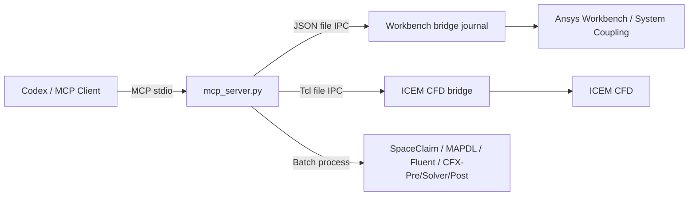

# Ansys Workbench MCP

<div align="center">

[English](README.en.md) | [简体中文](README.md) | [繁體中文](README.zh-TW.md) | [한국어](README.ko.md) | **日本語**

</div>


Codex またはその他の MCP クライアントから **SpaceClaim、Ansys Workbench、System Coupling、ICEM CFD、MAPDL、Fluent、CFX-Pre、CFX Solver、CFD-Post** を直接制御します。

本プロジェクトは、マウス操作や画面認識に依存せず、Ansys が公式にサポートする Journal、Workbench Scripting、Tcl/Replay、バッチ実行インターフェースを使用します。

> [!NOTE]
> 本プロジェクトは Ansys の公式製品ではありません。現在は Windows を対象とし、Ansys 2025 R1 の実機環境で検証済みです。

## 主な機能

| モジュール | 機能 |
| --- | --- |
| スクリプトと SpaceClaim | `.wbjn/.py/.tcl/.rpl/.jou/.ccl/.pre/.cse` を安全に書き込み、SpaceClaim Python を batch モードで実行 |
| Workbench | bridge の起動・停止、スクリプト実行、プロジェクトの取得/オープン/保存/更新、解析システムの作成 |
| ICEM CFD | GUI または batch セッションの起動、Tcl/Replay の実行、コマンド検索、Replay ファイルの実行 |
| Mechanical / MAPDL | 熱、構造、動力学システムの作成、APDL 入力ファイルの直接実行 |
| Fluent | journal/TUI の直接実行、互換性のある Workbench テンプレートがある場合のシステム作成 |
| CFX | CFX-Pre session、CFX Solver `.def`、CFD-Post `.cse` を batch モードで実行 |
| System Coupling / FSI | CFX–Transient Structural 双方向流体構造連成プロジェクトの作成、参加システムの接続、転送とソルバー制御の設定、実行またはエクスポート |

対応する Workbench システムは、Steady-State Thermal、Transient Thermal、Static Structural、Transient Structural、Modal、Harmonic Response、Response Spectrum、Random Vibration、CFX、System Coupling、およびインストール済みの Fluent テンプレートです。

## 仕組み



Workbench と ICEM のコマンド、結果、ログはランタイムディレクトリに書き込まれます。これらのディレクトリは自動作成され、`.gitignore` によって除外されます。

## クイックスタート

### 1. インストール

```powershell
cd D:\
git clone https://github.com/hongwenwang36-eng/ANSYS-Workbench-mcp.git ansys-workbench-mcp
cd D:\ansys-workbench-mcp
py -3.13 -m venv .venv
.\.venv\Scripts\python.exe -m pip install -r requirements.txt
```

Python 3.13 がない場合は、`py -0p` でインストール済みのバージョンを確認し、上記のバージョン番号を置き換えてください。

### 2. Codex の設定

`%USERPROFILE%\.codex\config.toml` に以下を追加します。

```toml
[mcp_servers.ansys-workbench]
command = 'D:\ansys-workbench-mcp\.venv\Scripts\python.exe'
args = ['D:\ansys-workbench-mcp\mcp_server.py']
cwd = 'D:\ansys-workbench-mcp'
startup_timeout_sec = 30
tool_timeout_sec = 600
enabled = true

[mcp_servers.ansys-workbench.env]
ANSYS_WORKBENCH_MCP_HOME = 'D:\ansys-workbench-mcp'
ANSYS_RUNWB2 = 'D:\Program Files\ANSYS Inc\v251\Framework\bin\Win64\RunWB2.exe'
ANSYS_MECHANICAL = 'D:\Program Files\ANSYS Inc\v251\aisol\bin\winx64\AnsysWBU.exe'
ANSYS_MAPDL = 'D:\Program Files\ANSYS Inc\v251\ansys\bin\winx64\ANSYS251.exe'
ANSYS_FLUENT = 'D:\Program Files\ANSYS Inc\v251\fluent\ntbin\win64\fluent.exe'
ANSYS_SPACECLAIM = 'D:\Program Files\ANSYS Inc\v251\scdm\SpaceClaim.exe'
ANSYS_CFX_SOLVE = 'D:\Program Files\ANSYS Inc\v251\CFX\bin\cfx5solve.exe'
ANSYS_CFX_PRE = 'D:\Program Files\ANSYS Inc\v251\CFX\bin\cfx5pre.exe'
ANSYS_CFX_POST = 'D:\Program Files\ANSYS Inc\v251\CFX\bin\cfx5post.exe'
ANSYS_ICEM_CFD = 'D:\Program Files\ANSYS Inc\v251\icemcfd\win64_amd\bin\icemcfd.bat'
```

Ansys のインストール先が異なる場合は、対応する環境変数を変更してください。保存後、Codex を再起動します。

### 3. 接続の確認

Codex で次のツールを順番に呼び出します。

```text
check_ansys_installation
start_workbench_bridge
check_workbench_connection
```

接続に成功すると、Codex からシステムの作成、スクリプトの実行、プロジェクトの操作が可能になります。

## よく使う操作

### Workbench

```text
# Steady-State Thermal システムを作成
create_steady_state_thermal_system_live(
  project_dir="D:/ansys-projects",
  project_name="thermal_case"
)

# CFX システムを作成
create_cfx_flow_system_live(
  project_dir="D:/ansys-projects",
  project_name="cfx_case"
)

# 現在のプロジェクトを取得して保存
get_project_info
save_project
```

常駐 bridge が不要な一回限りの処理には、`run_workbench_journal`、`create_workbench_analysis_system`、または `create_and_run_thermal_bar_demo` を使用できます。

### 形状から CFX 平衡位置までの一連のワークフロー

新しい実行ツールは形状から平衡反復までを接続します。`write_ansys_script` と `run_spaceclaim_script` で形状を作成し、ICEM bridge または Replay でメッシュを生成し、`run_cfx_pre_session` で設定と `.def` を作成し、`run_cfx_solver` で解析した後、`run_cfx_post_session` で荷重、モーメント、場データをエクスポートします。外側の反復は `run_workbench_journal` でパラメータを更新し、Newton-Raphson または減衰反復を実行できます。新しい出力とログマーカーの検査により、古いファイルを今回の成功と誤認しません。

### CFX–Mechanical 双方向 FSI

```text
# 1. 3つのシステムを作成し、2つの参加システムを接続
create_cfx_mechanical_fsi_project_live(
  project_dir="D:/ansys-projects/fsi",
  project_name="cfx_mechanical_fsi"
)

# 2. CFX と Mechanical でメッシュ、非定常物理、連成境界を設定し、Setup を更新
# 3. 実際に公開された参加システム、領域、変数名を取得
get_system_coupling_status_live

# 4. 連成の時間刻みと反復回数を設定
configure_system_coupling_settings_live(
  step_size="0.001 [s]",
  end_time="0.1 [s]",
  minimum_iterations=1,
  maximum_iterations=10
)

# 5. 前の手順で返された正確な名前を使って双方向転送を作成
configure_cfx_mechanical_two_way_fsi_live(...)

# 6. 検証後に解析を実行
run_system_coupling_solution_live
```

双方向 FSI には、Mechanical 変位 → CFX メッシュ変位と、CFX 流体力 → Mechanical 荷重の2つの転送があります。プロジェクト作成ツールはメッシュ、材料、境界、インターフェース領域を推測して作成しません。これらの物理入力は実際のモデルから与える必要があります。

### ICEM CFD

```text
# ヘッドレスセッションを開始
start_icem_bridge(batch=true)

# セッションと Blocking コマンドを確認
get_icem_session_info
list_icem_commands(pattern="ic_hex_*", limit=300)

# Tcl/Replay を実行
execute_icem_script(script="ic_load_tetin {D:/cases/model.tin}")

# Replay ファイルを一度だけ実行
run_icem_replay(
  replay_file="D:/cases/mesh.rpl",
  workdir="D:/cases"
)
```

信頼できるパラメータ実行のため、まず ICEM Replay Control でコマンドを記録し、その後 MCP に渡すことを推奨します。

### ソルバーの直接実行

```text
run_mapdl_input(input_file="D:/cases/model.dat")
run_fluent_journal(journal_path="D:/cases/run.jou")
run_cfx_pre_session(session_file="D:/cases/setup.pre", expected_output="D:/cases/model.def")
run_cfx_solver(definition_file="D:/cases/model.def")
run_cfx_post_session(session_file="D:/cases/export.cse", result_file="D:/cases/model.res")
```

## MCP ツール

<details>
<summary>全50ツールを表示</summary>

| ツール | 説明 |
| --- | --- |
| `check_ansys_installation` | Ansys 実行ファイルと bridge のパスを確認 |
| `write_ansys_script` | 対応する Ansys スクリプトを安全に書き込み、既定では上書きを禁止 |
| `check_icem_installation` | ICEM CFD と Tcl bridge を確認 |
| `start_icem_bridge` | ICEM CFD 常駐セッションを開始 |
| `stop_icem_bridge` | ICEM CFD 常駐セッションを停止 |
| `check_icem_connection` | ICEM bridge 接続を確認 |
| `execute_icem_script` | ICEM で Tcl/Replay を実行 |
| `get_icem_session_info` | ICEM セッション情報を取得 |
| `list_icem_commands` | ICEM Tcl コマンドを検索 |
| `run_icem_replay` | Replay ファイルを batch モードで実行 |
| `start_workbench_bridge` | Workbench bridge を開始 |
| `stop_workbench_bridge` | Workbench bridge を停止 |
| `check_workbench_connection` | Workbench 接続を確認 |
| `execute_workbench_script` | Workbench でスクリプトを実行 |
| `get_project_info` | 現在のプロジェクト情報を取得 |
| `open_project` | `.wbpj` プロジェクトを開く |
| `save_project` | 現在のプロジェクトを保存 |
| `update_project` | プロジェクトを更新 |
| `probe_workbench_analysis_templates_live` | 利用可能な解析テンプレートを検索 |
| `probe_system_coupling_live` | System Coupling テンプレートとスクリプトインターフェースを確認 |
| `create_cfx_mechanical_fsi_project_live` | CFX–Mechanical–System Coupling プロジェクトを作成して接続 |
| `connect_system_coupling_participants_live` | 既存システムを連成参加システムとして接続 |
| `get_system_coupling_status_live` | 参加システム、領域、変数、転送、設定を取得 |
| `configure_system_coupling_settings_live` | 連成の時間刻み、期間、反復制御を設定 |
| `create_system_coupling_data_transfer_live` | 汎用データ転送を作成 |
| `configure_cfx_mechanical_two_way_fsi_live` | 双方向 FSI の変位転送と力転送を作成 |
| `export_system_coupling_setup_live` | System Coupling `.sci` 設定をエクスポート |
| `run_system_coupling_solution_live` | 連成 Solution を更新して実行 |
| `create_workbench_analysis_system_live` | 汎用解析システムを作成 |
| `create_steady_state_thermal_system_live` | Steady-State Thermal システムを作成 |
| `create_transient_thermal_system_live` | Transient Thermal システムを作成 |
| `create_static_structural_system_live` | Static Structural システムを作成 |
| `create_transient_structural_system_live` | Transient Structural システムを作成 |
| `create_modal_analysis_system_live` | Modal システムを作成 |
| `create_harmonic_response_system_live` | Harmonic Response システムを作成 |
| `create_response_spectrum_system_live` | Response Spectrum システムを作成 |
| `create_random_vibration_system_live` | Random Vibration システムを作成 |
| `create_cfx_flow_system_live` | CFX システムを作成 |
| `create_fluent_flow_system_live` | Fluent システムの作成を試行 |
| `create_thermal_bar_demo_live` | 熱解析デモを作成して実行 |
| `run_spaceclaim_script` | SpaceClaim Python を batch モードで実行し形状出力を検証 |
| `run_cfx_pre_session` | CFX-Pre session を batch モードで実行し `.cfx/.def` 出力を検証 |
| `run_cfx_post_session` | CFD-Post `.cse` を batch モードで実行しエクスポート結果を検証 |
| `run_workbench_journal` | Workbench journal を batch モードで実行し、ログマーカーと結果ファイルを任意で検証 |
| `create_workbench_analysis_system` | 解析システムを batch モードで作成 |
| `create_steady_state_thermal_system` | Steady-State Thermal システムを batch モードで作成 |
| `run_mapdl_input` | MAPDL 入力ファイルを実行 |
| `run_fluent_journal` | Fluent journal を実行 |
| `run_cfx_solver` | CFX `.def` ファイルを実行 |
| `create_and_run_thermal_bar_demo` | 熱解析デモを batch モードで実行 |

</details>

## MCP リソース

| URI | 内容 |
| --- | --- |
| `ansys-workbench://status` | Workbench bridge の状態 |
| `ansys-workbench://installation` | Ansys インストールパスの確認結果 |
| `ansys-workbench://icem/status` | ICEM CFD bridge の状態 |

## 検証状況

以下の項目は Ansys 2025 R1 の実機環境で検証済みです。

- 50個の MCP ツールと3個のリソースの登録
- Workbench bridge の起動・停止、スクリプト実行、プロジェクトの取得/オープン/保存/更新
- Steady-State Thermal、Transient Thermal、Static Structural、Transient Structural、Modal、Harmonic Response、Response Spectrum、Random Vibration、CFX システムの作成
- System Coupling テンプレート、CFX/Transient Structural 参加システムの接続、3システム FSI プロジェクトの保存
- Workbench と MAPDL の熱解析：525ノード、20–100 °C、MAPDL エラー0件
- Fluent `3ddp` journal のヘッドレス実行
- ICEM CFD bridge、Tcl/Replay、コマンド検索、batch モード
- SpaceClaim、CFX-Pre、CFD-Post の batch 実行と新規出力チェック
- 実際の `.res` から PAD 圧力、座標、面接続データを出力する CFD-Post `.cse`

現在の制限事項：

- 検証した Workbench 環境では一般的な Fluent テンプレートが見つかりませんでしたが、`run_fluent_journal` は検証済みです。
- `run_cfx_solver` のパスと呼び出しロジックは確認済みですが、完全な解析にはユーザーが提供する有効な `.def` ファイルが必要です。
- MCP は実行チェーン全体を提供しますが、形状パラメータ、境界条件、収束条件、Newton-Raphson Jacobian を推測しません。実モデル用に検証したスクリプトで定義する必要があります。
- 双方向転送と連成解析には、実際の CFX/Mechanical メッシュ、System Coupling の領域と変数が必要です。空のプロジェクトで検証できるのはシステムトポロジーのみで、物理ケースの代わりにはなりません。

## トラブルシューティング

| 問題 | 対処方法 |
| --- | --- |
| Codex にツールが表示されない | `config.toml` のパスを確認し、Codex を再起動 |
| Ansys のパスが存在しない | 対応する `ANSYS_*` 環境変数を修正 |
| Workbench bridge がタイムアウトする | `stop_workbench_bridge` を実行してから再起動し、`mcp.log` を確認 |
| ICEM bridge がタイムアウトする | `start_icem_bridge(batch=true)` で開始し、`icem/icem_bridge.log` を確認 |
| Fluent テンプレートが利用できない | `run_fluent_journal` を使用するか、`template_name` でインストール済みテンプレートを指定 |

## 開発とテスト

```powershell
.\.venv\Scripts\python.exe -m unittest discover -s tests -v
```

テストでは README、登録済みの50ツール、3リソース、bridge バージョンの一致、安全なスクリプト書き込み、CFX 前後処理コマンド、ICEM IPC の動作を確認します。

## ライセンス

[MIT](LICENSE)
