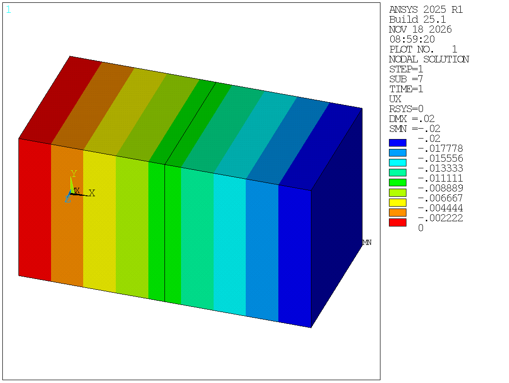
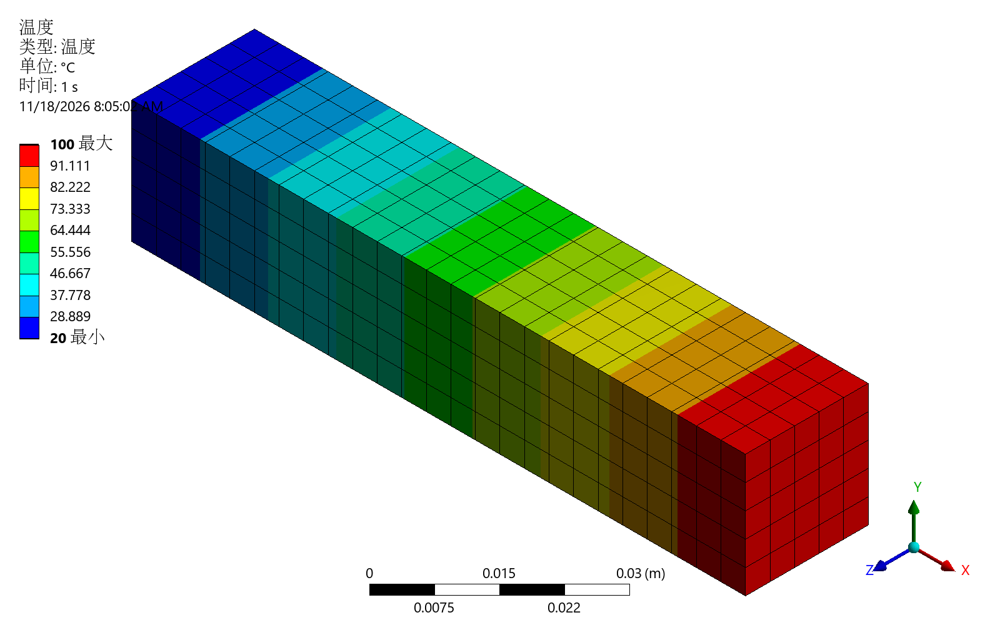
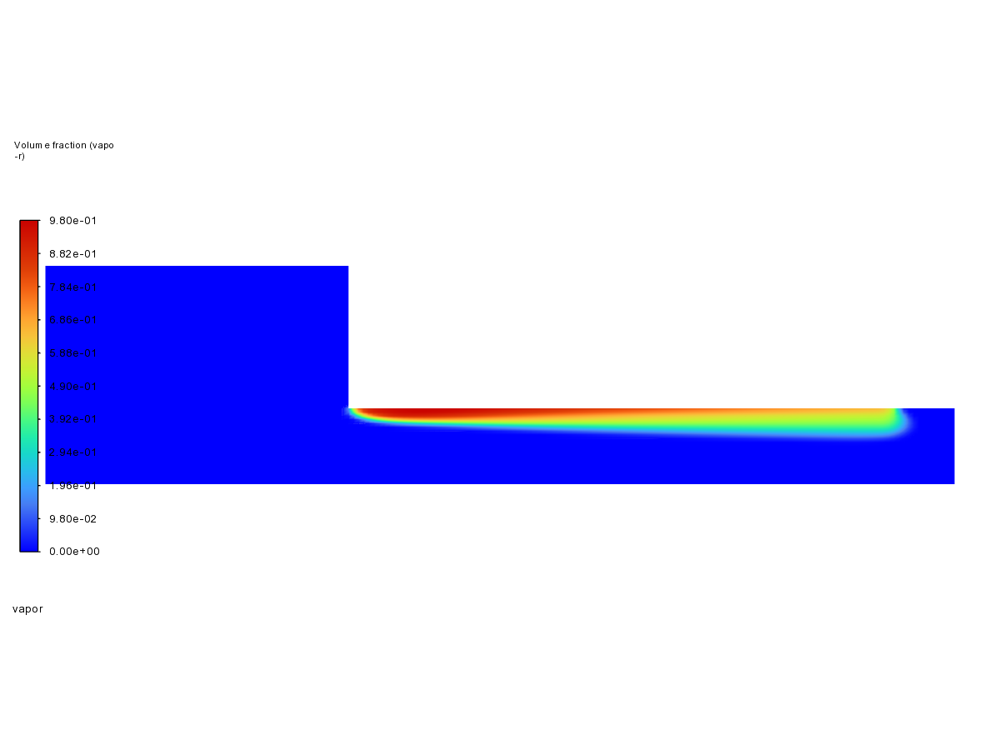
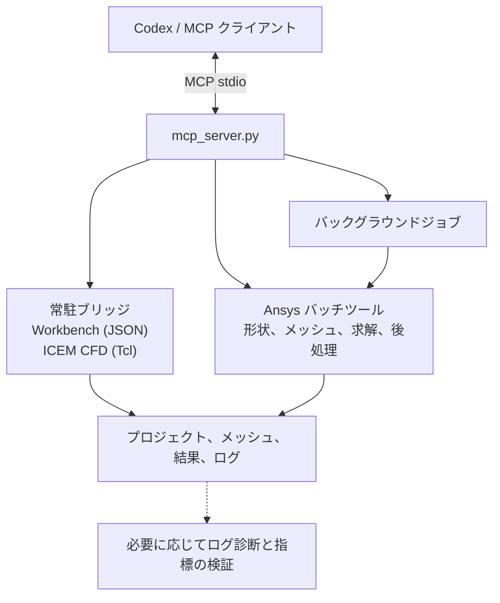

# Ansys Workbench MCP

<div align="center">

[English](README.en.md) | [简体中文](README.md) | [繁體中文](README.zh-TW.md) | [한국어](README.ko.md) | **日本語**

</div>


Codex またはその他の MCP クライアントから **SpaceClaim、Ansys Workbench、Ansys Meshing、System Coupling、ICEM CFD、MAPDL、Fluent、CFX-Pre、CFX Solver、CFD-Post** を直接制御します。

本プロジェクトは、マウス操作や画面認識に依存せず、Ansys が公式にサポートする Journal、Workbench Scripting、Tcl/Replay、バッチ実行インターフェースを使用します。

> [!NOTE]
> 本プロジェクトは Ansys の公式製品ではありません。現在は Windows を対象とし、Ansys 2025 R1 の実機環境で検証済みです。

## 対応するシミュレーション

| 解析 | ソルバー | 実機で検証した範囲 |
| --- | --- | --- |
| 静的・非線形構造解析 | Mechanical APDL | 線形静解析、摩擦なし接触、二直線塑性 |
| 構造動力学 | Mechanical APDL | モード、予応力付きモード、調和応答、過渡応答、応答スペクトル、ランダム振動 |
| 熱解析 | Mechanical、Mechanical APDL | 定常熱伝導、過渡加熱 |
| 熱構造連成 | Mechanical APDL | 温度場を構造モデルに転送し、熱膨張を計算 |
| 流体解析 | Fluent、CFX | 流路内流れ、静的混合、キャビテーション |
| 共役熱伝達 | Fluent | 流体と固体の温度場を求め、界面の熱流量を確認 |
| 双方向流体構造連成 | System Coupling、Fluent、Mechanical APDL | 流体力と構造変位を交換。CFX–Mechanical の Workbench 構成はシステム接続まで検証 |

## 実機検証例

**非線形接触解析 · 軸方向変位**



**定常熱伝導解析 · 温度**



**Fluent キャビテーション解析 · 蒸気体積分率**



## 仕組み

Codex などの MCP クライアントは、標準入出力（stdio）を通じてローカルの Python サーバーを呼び出します。サーバーはツールに応じて常駐ブリッジまたはバッチ実行を使い、状態、ログの抜粋、ファイルのパスなどを MCP で返します。



- **常駐ブリッジ。** Workbench は JSON コマンドファイルを受け取り、現在のプロジェクトセッションで解析システムの作成、プロジェクトの更新、System Coupling の設定を行います。ICEM CFD は Tcl コマンドファイルを使い、現在のセッションでスクリプトを実行します。どちらのブリッジも JSON で応答します。
- **バッチ実行。** サーバーはジャーナル、スクリプト、ソルバーの入力ファイルを Ansys プログラムに渡します。SpaceClaim の形状処理、単体の Ansys Meshing、ICEM Replay、MAPDL、Fluent、CFX、CFD-Post、単体の System Coupling に対応します。双方向流体構造連成では、単体の System Coupling を使って Fluent と MAPDL の間で流体力と構造変位を交換できます。
- **バックグラウンドジョブ。** 時間のかかるバッチ処理は `start_ansys_job` で開始できます。再接続後もジョブ ID を使って `get_ansys_job` で状態やログを確認でき、`stop_ansys_job` でローカルジョブを中止できます。
- **結果の確認。** `diagnose_ansys_log` はソルバーログのエラー箇所を特定し、`verify_simulation` は CSV の指標を指定単位としきい値に照らして確認します。サーバーは必要に応じて `commands/`、`results/`、`icem/`、`runs/` などの実行用ディレクトリを作成します。これらは `.gitignore` で除外されます。

## クイックスタート

### 1. インストール

```powershell
cd D:\
git clone https://github.com/hongwenwang36-eng/ANSYS-Workbench-mcp.git ansys-workbench-mcp
cd D:\ansys-workbench-mcp
py -3.13 -m venv .venv
.\.venv\Scripts\python.exe -m pip install -r requirements.txt
```

Python 3.13 がない場合は、`py -0p` でインストール済みのバージョンを確認し、上記のバージョン番号を置き換えてください。

### 2. Codex の設定

`%USERPROFILE%\.codex\config.toml` に以下を追加します。

```toml
[mcp_servers.ansys-workbench]
command = 'D:\ansys-workbench-mcp\.venv\Scripts\python.exe'
args = ['D:\ansys-workbench-mcp\mcp_server.py']
cwd = 'D:\ansys-workbench-mcp'
startup_timeout_sec = 30
tool_timeout_sec = 600
enabled = true

[mcp_servers.ansys-workbench.env]
ANSYS_WORKBENCH_MCP_HOME = 'D:\ansys-workbench-mcp'
ANSYS_RUNWB2 = 'D:\Program Files\ANSYS Inc\v251\Framework\bin\Win64\RunWB2.exe'
ANSYS_MECHANICAL = 'D:\Program Files\ANSYS Inc\v251\aisol\bin\winx64\AnsysWBU.exe'
ANSYS_MAPDL = 'D:\Program Files\ANSYS Inc\v251\ansys\bin\winx64\ANSYS251.exe'
ANSYS_FLUENT = 'D:\Program Files\ANSYS Inc\v251\fluent\ntbin\win64\fluent.exe'
ANSYS_SPACECLAIM = 'D:\Program Files\ANSYS Inc\v251\scdm\SpaceClaim.exe'
ANSYS_CFX_SOLVE = 'D:\Program Files\ANSYS Inc\v251\CFX\bin\cfx5solve.exe'
ANSYS_CFX_PRE = 'D:\Program Files\ANSYS Inc\v251\CFX\bin\cfx5pre.exe'
ANSYS_CFX_POST = 'D:\Program Files\ANSYS Inc\v251\CFX\bin\cfx5post.exe'
ANSYS_ICEM_CFD = 'D:\Program Files\ANSYS Inc\v251\icemcfd\win64_amd\bin\icemcfd.bat'
ANSYS_SYSTEM_COUPLING = 'D:\Program Files\ANSYS Inc\v251\SystemCoupling\bin\systemcoupling.bat'
```

Ansys のインストール先が異なる場合は、対応する環境変数を変更してください。保存後、Codex を再起動します。

### 3. 接続の確認

まず `check_ansys_installation` で実行ファイルのパスを確認します。現在の Workbench プロジェクトを操作する場合は、bridge を起動して接続を確認します。

```text
start_workbench_bridge
check_workbench_connection
```

独立した Ansys Meshing とソルバーのバッチツールは直接実行できます。

## Skill と実機検証例

12 個のプロジェクト Skill は、ワークフロー、形状、メッシュ、構造・動力学、熱、CFD、連成、パラメーター検討、診断、検証、ポスト処理を扱います。 [Skill 一覧と実行例](docs/skills-and-validation.md)

[実機検証記録](docs/validation-record.md) · [Ansys Meshing と ICEM の例](examples/meshing/README.md)

## MCP ツール

<details>
<summary>全57ツールを表示</summary>

| ツール | 説明 |
| --- | --- |
| `check_ansys_installation` | Ansys 実行ファイルと bridge のパスを確認 |
| `write_ansys_script` | 対応する Ansys スクリプトを安全に書き込み、既定では上書きを禁止 |
| `check_icem_installation` | ICEM CFD と Tcl bridge を確認 |
| `start_icem_bridge` | ICEM CFD 常駐セッションを開始 |
| `stop_icem_bridge` | ICEM CFD 常駐セッションを停止 |
| `check_icem_connection` | ICEM bridge 接続を確認 |
| `execute_icem_script` | ICEM で Tcl/Replay を実行 |
| `get_icem_session_info` | ICEM セッション情報を取得 |
| `list_icem_commands` | ICEM Tcl コマンドを検索 |
| `run_icem_replay` | Replay ファイルを batch モードで実行 |
| `start_workbench_bridge` | Workbench bridge を開始 |
| `stop_workbench_bridge` | Workbench bridge を停止 |
| `check_workbench_connection` | Workbench 接続を確認 |
| `execute_workbench_script` | Workbench でスクリプトを実行 |
| `get_project_info` | 現在のプロジェクト情報を取得 |
| `open_project` | `.wbpj` プロジェクトを開く |
| `save_project` | 現在のプロジェクトを保存 |
| `update_project` | プロジェクトを更新 |
| `probe_workbench_analysis_templates_live` | 利用可能な解析テンプレートを検索 |
| `probe_system_coupling_live` | System Coupling テンプレートとスクリプトインターフェースを確認 |
| `create_cfx_mechanical_fsi_project_live` | CFX–Mechanical–System Coupling プロジェクトを作成して接続 |
| `connect_system_coupling_participants_live` | 既存システムを連成参加システムとして接続 |
| `get_system_coupling_status_live` | 参加システム、領域、変数、転送、設定を取得 |
| `configure_system_coupling_settings_live` | 連成の時間刻み、期間、反復制御を設定 |
| `create_system_coupling_data_transfer_live` | 汎用データ転送を作成 |
| `configure_cfx_mechanical_two_way_fsi_live` | 双方向 FSI の変位転送と力転送を作成 |
| `export_system_coupling_setup_live` | System Coupling `.sci` 設定をエクスポート |
| `run_system_coupling_solution_live` | 連成 Solution を更新して実行 |
| `create_workbench_analysis_system_live` | 汎用解析システムを作成 |
| `create_steady_state_thermal_system_live` | Steady-State Thermal システムを作成 |
| `create_transient_thermal_system_live` | Transient Thermal システムを作成 |
| `create_static_structural_system_live` | Static Structural システムを作成 |
| `create_transient_structural_system_live` | Transient Structural システムを作成 |
| `create_modal_analysis_system_live` | Modal システムを作成 |
| `create_harmonic_response_system_live` | Harmonic Response システムを作成 |
| `create_response_spectrum_system_live` | Response Spectrum システムを作成 |
| `create_random_vibration_system_live` | Random Vibration システムを作成 |
| `create_cfx_flow_system_live` | CFX システムを作成 |
| `create_fluent_flow_system_live` | Fluent システムの作成を試行 |
| `create_thermal_bar_demo_live` | 熱解析デモを作成して実行 |
| `run_spaceclaim_script` | SpaceClaim Python を batch モードで実行し形状出力を検証 |
| `run_cfx_pre_session` | CFX-Pre session を batch モードで実行し `.cfx/.def` 出力を検証 |
| `run_cfx_post_session` | CFD-Post `.cse` を batch モードで実行しエクスポート結果を検証 |
| `generate_ansys_mesh` | 独立した Ansys Meshing システムでメッシュを生成・出力 |
| `run_workbench_journal` | Workbench journal を batch モードで実行し、ログマーカーと結果ファイルを任意で検証 |
| `create_workbench_analysis_system` | 解析システムを batch モードで作成 |
| `create_steady_state_thermal_system` | Steady-State Thermal システムを batch モードで作成 |
| `run_system_coupling_script` | System Coupling Python batch |
| `start_ansys_job` | バックグラウンドジョブを開始 |
| `get_ansys_job` | 状態とログを取得 |
| `stop_ansys_job` | 指定ジョブを停止 |
| `diagnose_ansys_log` | ログからエラーを抽出 |
| `verify_simulation` | CSV の単位と許容範囲を検査 |
| `run_mapdl_input` | MAPDL 入力ファイルを実行 |
| `run_fluent_journal` | Fluent journal を実行 |
| `run_cfx_solver` | CFX `.def` ファイルを実行 |
| `create_and_run_thermal_bar_demo` | 熱解析デモを batch モードで実行 |

</details>

## MCP リソース

| URI | 内容 |
| --- | --- |
| `ansys-workbench://status` | Workbench bridge の状態 |
| `ansys-workbench://installation` | Ansys インストールパスの確認結果 |
| `ansys-workbench://icem/status` | ICEM CFD bridge の状態 |

## トラブルシューティング

| 問題 | 対処方法 |
| --- | --- |
| Codex にツールが表示されない | `config.toml` のパスを確認し、Codex を再起動 |
| Ansys のパスが存在しない | 対応する `ANSYS_*` 環境変数を修正 |
| Workbench bridge がタイムアウトする | `stop_workbench_bridge` を実行してから再起動し、`mcp.log` を確認 |
| ICEM bridge がタイムアウトする | `start_icem_bridge(batch=true)` で開始し、`icem/icem_bridge.log` を確認 |
| Fluent テンプレートが利用できない | `run_fluent_journal` を使用するか、`template_name` でインストール済みテンプレートを指定 |

MCP クライアントが使えない場合は、リポジトリのルートで `.\.venv\Scripts\python.exe stop_mcp.py` を実行すると、bridge の作業ディレクトリに停止信号を書き込みます。

## 開発とテスト

```powershell
.\.venv\Scripts\python.exe -m unittest discover -s tests -v
```

テストでは README、登録済みの57ツール、3リソース、bridge バージョンの一致、安全なスクリプト書き込み、CFX 前後処理コマンド、ICEM IPC の動作を確認します。

## ライセンス

[MIT](LICENSE)

## このバージョンの変更

### 追加

- 形状、メッシュ、解析、検証、ポスト処理などを扱う 12 個の ANSYS Skill を追加。
- `generate_ansys_mesh` を追加。形状から独立した Mesh プロジェクトを作成し、メッシュ制御を適用して `.meshdat` を出力し、再オープン後に統計を確認。
- バックグラウンドジョブの開始・照会・停止、ログ診断、CSV の数値検証、独立した System Coupling のバッチ実行を追加。MCP ツールは 50 個から 57 個に増加。
- 構造・動力学、熱、メッシュ、Fluent、CFX、連成の再実行可能な例と検証記録を追加。

### 変更と修正

- バッチ出力の検証を強化し、空のファイルを失敗として扱うように変更。バックグラウンドジョブの停止時に、所属する Windows ジョブのプロセスを終了。
- Fluent のバッチ画像出力、Mechanical の節点 CSV 出力、プロジェクト再オープン後の画像更新を修正。
- 5 言語の README を整理し、対応解析、実機のコンター図、バージョン変更を掲載。
