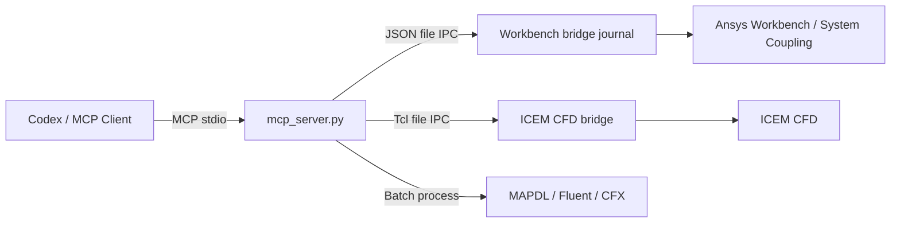

# Ansys Workbench MCP

<div align="center">

[English](README.en.md) | [简体中文](README.md) | [繁體中文](README.zh-TW.md) | **한국어** | [日本語](README.ja.md)

</div>


Codex 또는 다른 MCP 클라이언트에서 **Ansys Workbench**를 직접 제어합니다.

이 프로젝트는 마우스 클릭이나 화면 인식에 의존하지 않고 Ansys가 공식 지원하는 Journal, Workbench Scripting, Tcl/Replay 및 배치 실행 인터페이스를 사용합니다.

> [!NOTE]
> 이 프로젝트는 Ansys 공식 제품이 아닙니다. 현재 Windows를 대상으로 하며 Ansys 2025 R1 실제 설치 환경에서 검증되었습니다.

## 주요 기능

| 모듈 | 기능 |
| --- | --- |
| Workbench | bridge 시작/종료, 스크립트 실행, 프로젝트 조회/열기/저장/업데이트, 해석 시스템 생성 |
| ICEM CFD | GUI 또는 batch 세션 시작, Tcl/Replay 실행, 명령 검색, Replay 파일 실행 |
| Mechanical / MAPDL | 열, 구조 및 동역학 시스템 생성, APDL 입력 파일 직접 실행 |
| Fluent | journal/TUI 직접 실행, 호환되는 Workbench 템플릿이 있으면 시스템 생성 |
| CFX | Workbench CFX 시스템 생성 및 `.def` 파일 직접 실행 |
| System Coupling / FSI | CFX–Transient Structural 양방향 유체-구조 연성 프로젝트 생성, 참여자 연결, 전송 및 솔버 제어 설정, 실행 또는 내보내기 |

지원되는 Workbench 시스템은 Steady-State Thermal, Transient Thermal, Static Structural, Transient Structural, Modal, Harmonic Response, Response Spectrum, Random Vibration, CFX, System Coupling 및 설치된 Fluent 템플릿입니다.

## 동작 방식



Workbench와 ICEM의 명령, 결과 및 로그는 런타임 디렉터리에 기록됩니다. 이 디렉터리는 자동으로 생성되며 `.gitignore`에서 제외됩니다.

## 빠른 시작

### 1. 설치

```powershell
cd D:\
git clone https://github.com/hongwenwang36-eng/ANSYS-Workbench-mcp.git ansys-workbench-mcp
cd D:\ansys-workbench-mcp
py -3.13 -m venv .venv
.\.venv\Scripts\python.exe -m pip install -r requirements.txt
```

Python 3.13이 없다면 `py -0p`로 설치된 버전을 확인한 뒤 위 버전 번호를 바꾸십시오.

### 2. Codex 설정

`%USERPROFILE%\.codex\config.toml`에 다음 내용을 추가합니다.

```toml
[mcp_servers.ansys-workbench]
command = 'D:\ansys-workbench-mcp\.venv\Scripts\python.exe'
args = ['D:\ansys-workbench-mcp\mcp_server.py']
cwd = 'D:\ansys-workbench-mcp'
startup_timeout_sec = 30
tool_timeout_sec = 600
enabled = true

[mcp_servers.ansys-workbench.env]
ANSYS_WORKBENCH_MCP_HOME = 'D:\ansys-workbench-mcp'
ANSYS_RUNWB2 = 'D:\Program Files\ANSYS Inc\v251\Framework\bin\Win64\RunWB2.exe'
ANSYS_MECHANICAL = 'D:\Program Files\ANSYS Inc\v251\aisol\bin\winx64\AnsysWBU.exe'
ANSYS_MAPDL = 'D:\Program Files\ANSYS Inc\v251\ansys\bin\winx64\ANSYS251.exe'
ANSYS_FLUENT = 'D:\Program Files\ANSYS Inc\v251\fluent\ntbin\win64\fluent.exe'
ANSYS_CFX_SOLVE = 'D:\Program Files\ANSYS Inc\v251\CFX\bin\cfx5solve.exe'
ANSYS_CFX_PRE = 'D:\Program Files\ANSYS Inc\v251\CFX\bin\cfx5pre.exe'
ANSYS_ICEM_CFD = 'D:\Program Files\ANSYS Inc\v251\icemcfd\win64_amd\bin\icemcfd.bat'
```

Ansys 설치 위치가 다르면 해당 환경 변수를 수정하십시오. 저장 후 Codex를 다시 시작합니다.

### 3. 연결 확인

Codex에서 다음 도구를 순서대로 호출합니다.

```text
check_ansys_installation
start_workbench_bridge
check_workbench_connection
```

연결에 성공하면 Codex로 시스템 생성, 스크립트 실행 및 프로젝트 작업을 수행할 수 있습니다.

## 일반적인 작업

### Workbench

```text
# Steady-State Thermal 시스템 생성
create_steady_state_thermal_system_live(
  project_dir="D:/ansys-projects",
  project_name="thermal_case"
)

# CFX 시스템 생성
create_cfx_flow_system_live(
  project_dir="D:/ansys-projects",
  project_name="cfx_case"
)

# 현재 프로젝트 조회 및 저장
get_project_info
save_project
```

상주 bridge가 필요 없는 일회성 작업에는 `run_workbench_journal`, `create_workbench_analysis_system` 또는 `create_and_run_thermal_bar_demo`를 사용할 수 있습니다.

### CFX–Mechanical 양방향 FSI

```text
# 1. 세 시스템을 생성하고 두 참여자를 연결
create_cfx_mechanical_fsi_project_live(
  project_dir="D:/ansys-projects/fsi",
  project_name="cfx_mechanical_fsi"
)

# 2. CFX와 Mechanical에서 메시, 과도 물리 및 연성 경계를 완성한 후 Setup 새로 고침
# 3. 실제 게시된 참여자, 영역 및 변수 이름 조회
get_system_coupling_status_live

# 4. 연성 시간 간격과 반복 횟수 설정
configure_system_coupling_settings_live(
  step_size="0.001 [s]",
  end_time="0.1 [s]",
  minimum_iterations=1,
  maximum_iterations=10
)

# 5. 위에서 반환된 정확한 이름으로 양방향 전송 생성
configure_cfx_mechanical_two_way_fsi_live(...)

# 6. 검증 후 해석 실행
run_system_coupling_solution_live
```

양방향 FSI에는 Mechanical 변위 → CFX 메시 변위와 CFX 유체력 → Mechanical 하중의 두 전송이 포함됩니다. 프로젝트 생성 도구는 메시, 재료, 경계 또는 인터페이스 영역을 임의로 만들지 않으며, 이러한 물리 입력은 실제 모델에서 제공해야 합니다.

### ICEM CFD

```text
# 헤드리스 세션 시작
start_icem_bridge(batch=true)

# 세션 및 Blocking 명령 조회
get_icem_session_info
list_icem_commands(pattern="ic_hex_*", limit=300)

# Tcl/Replay 실행
execute_icem_script(script="ic_load_tetin {D:/cases/model.tin}")

# Replay 파일 일회 실행
run_icem_replay(
  replay_file="D:/cases/mesh.rpl",
  workdir="D:/cases"
)
```

신뢰할 수 있는 매개변수 실행을 위해 먼저 ICEM Replay Control로 명령을 기록한 뒤 MCP에 전달하는 것을 권장합니다.

### 솔버 직접 실행

```text
run_mapdl_input(input_file="D:/cases/model.dat")
run_fluent_journal(journal_path="D:/cases/run.jou")
run_cfx_solver(definition_file="D:/cases/model.def")
```

## MCP 도구

<details>
<summary>46개 도구 모두 보기</summary>

| 도구 | 설명 |
| --- | --- |
| `check_ansys_installation` | Ansys 실행 파일 및 bridge 경로 확인 |
| `check_icem_installation` | ICEM CFD 및 Tcl bridge 확인 |
| `start_icem_bridge` | ICEM CFD 상주 세션 시작 |
| `stop_icem_bridge` | ICEM CFD 상주 세션 종료 |
| `check_icem_connection` | ICEM bridge 연결 확인 |
| `execute_icem_script` | ICEM에서 Tcl/Replay 실행 |
| `get_icem_session_info` | ICEM 세션 정보 조회 |
| `list_icem_commands` | ICEM Tcl 명령 검색 |
| `run_icem_replay` | Replay 파일을 batch 모드로 실행 |
| `start_workbench_bridge` | Workbench bridge 시작 |
| `stop_workbench_bridge` | Workbench bridge 종료 |
| `check_workbench_connection` | Workbench 연결 확인 |
| `execute_workbench_script` | Workbench에서 스크립트 실행 |
| `get_project_info` | 현재 프로젝트 정보 조회 |
| `open_project` | `.wbpj` 프로젝트 열기 |
| `save_project` | 현재 프로젝트 저장 |
| `update_project` | 프로젝트 업데이트 |
| `probe_workbench_analysis_templates_live` | 사용 가능한 해석 템플릿 검색 |
| `probe_system_coupling_live` | System Coupling 템플릿 및 스크립팅 인터페이스 확인 |
| `create_cfx_mechanical_fsi_project_live` | CFX–Mechanical–System Coupling 프로젝트 생성 및 연결 |
| `connect_system_coupling_participants_live` | 기존 시스템을 연성 참여자로 연결 |
| `get_system_coupling_status_live` | 참여자, 영역, 변수, 전송 및 설정 조회 |
| `configure_system_coupling_settings_live` | 연성 시간 간격, 기간 및 반복 제어 설정 |
| `create_system_coupling_data_transfer_live` | 일반 데이터 전송 생성 |
| `configure_cfx_mechanical_two_way_fsi_live` | 양방향 FSI의 변위 및 힘 전송 생성 |
| `export_system_coupling_setup_live` | System Coupling `.sci` 설정 내보내기 |
| `run_system_coupling_solution_live` | 연성 Solution 업데이트 및 실행 |
| `create_workbench_analysis_system_live` | 일반 해석 시스템 생성 |
| `create_steady_state_thermal_system_live` | Steady-State Thermal 시스템 생성 |
| `create_transient_thermal_system_live` | Transient Thermal 시스템 생성 |
| `create_static_structural_system_live` | Static Structural 시스템 생성 |
| `create_transient_structural_system_live` | Transient Structural 시스템 생성 |
| `create_modal_analysis_system_live` | Modal 시스템 생성 |
| `create_harmonic_response_system_live` | Harmonic Response 시스템 생성 |
| `create_response_spectrum_system_live` | Response Spectrum 시스템 생성 |
| `create_random_vibration_system_live` | Random Vibration 시스템 생성 |
| `create_cfx_flow_system_live` | CFX 시스템 생성 |
| `create_fluent_flow_system_live` | Fluent 시스템 생성 시도 |
| `create_thermal_bar_demo_live` | 열 해석 데모 생성 및 실행 |
| `run_workbench_journal` | Workbench journal을 batch 모드로 실행 |
| `create_workbench_analysis_system` | 해석 시스템을 batch 모드로 생성 |
| `create_steady_state_thermal_system` | Steady-State Thermal 시스템을 batch 모드로 생성 |
| `run_mapdl_input` | MAPDL 입력 파일 실행 |
| `run_fluent_journal` | Fluent journal 실행 |
| `run_cfx_solver` | CFX `.def` 파일 실행 |
| `create_and_run_thermal_bar_demo` | 열 해석 데모를 batch 모드로 실행 |

</details>

## MCP 리소스

| URI | 내용 |
| --- | --- |
| `ansys-workbench://status` | Workbench bridge 상태 |
| `ansys-workbench://installation` | Ansys 설치 경로 확인 결과 |
| `ansys-workbench://icem/status` | ICEM CFD bridge 상태 |

## 검증 상태

다음 항목은 Ansys 2025 R1 실제 설치 환경에서 검증되었습니다.

- MCP 도구 46개와 리소스 3개 등록
- Workbench bridge 시작/종료, 스크립트 실행, 프로젝트 조회/열기/저장/업데이트
- Steady-State Thermal, Transient Thermal, Static Structural, Transient Structural, Modal, Harmonic Response, Response Spectrum, Random Vibration 및 CFX 시스템 생성
- System Coupling 템플릿, CFX/Transient Structural 참여자 연결, 세 시스템 FSI 프로젝트 저장
- Workbench 및 MAPDL 열 해석: 노드 525개, 20–100 °C, MAPDL 오류 0개
- Fluent `3ddp` journal 헤드리스 실행
- ICEM CFD bridge, Tcl/Replay, 명령 검색 및 batch 모드

현재 제한 사항:

- 테스트한 Workbench 설치에서 일반적인 Fluent 템플릿을 찾지 못했지만 `run_fluent_journal`은 검증되었습니다.
- `run_cfx_solver`의 경로 및 호출 로직은 확인했으나 전체 해석에는 사용자가 제공하는 유효한 `.def` 파일이 필요합니다.
- 양방향 전송 및 연성 해석에는 실제 CFX/Mechanical 메시, System Coupling 영역 및 변수가 필요합니다. 빈 프로젝트는 시스템 토폴로지만 검증하며 실제 물리 사례를 대신할 수 없습니다.

## 문제 해결

| 문제 | 해결 방법 |
| --- | --- |
| Codex에 도구가 표시되지 않음 | `config.toml` 경로를 확인하고 Codex를 다시 시작 |
| Ansys 경로가 존재하지 않음 | 해당 `ANSYS_*` 환경 변수 수정 |
| Workbench bridge 시간 초과 | `stop_workbench_bridge` 실행 후 다시 시작하고 `mcp.log` 확인 |
| ICEM bridge 시간 초과 | `start_icem_bridge(batch=true)`로 시작하고 `icem/icem_bridge.log` 확인 |
| Fluent 템플릿을 사용할 수 없음 | `run_fluent_journal`을 사용하거나 `template_name`으로 설치된 템플릿 지정 |

## 개발 및 테스트

```powershell
.\.venv\Scripts\python.exe -m unittest discover -s tests -v
```

테스트는 README, 등록된 도구 46개, 리소스 3개, bridge 버전 일치 및 ICEM IPC 동작을 확인합니다.

## 라이선스

[MIT](LICENSE)
