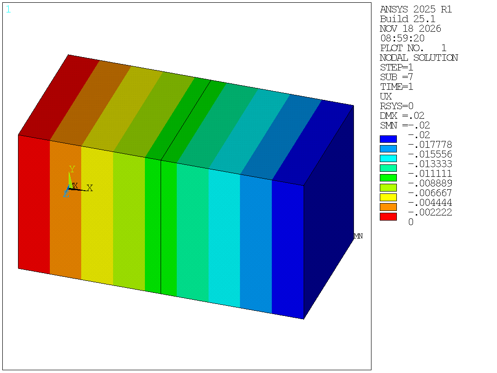
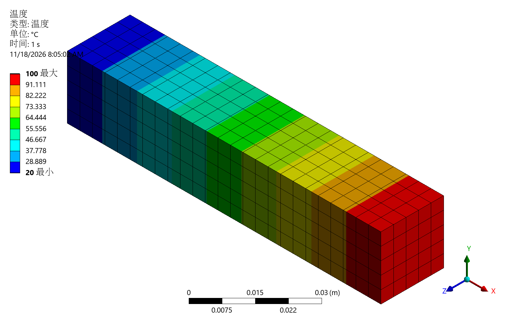
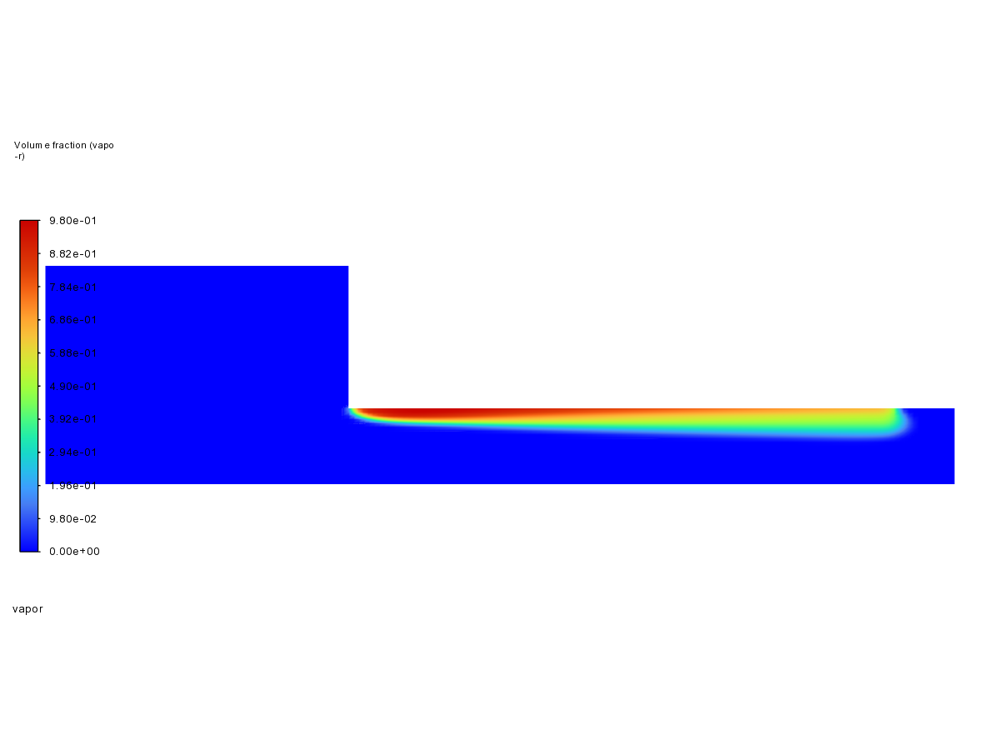
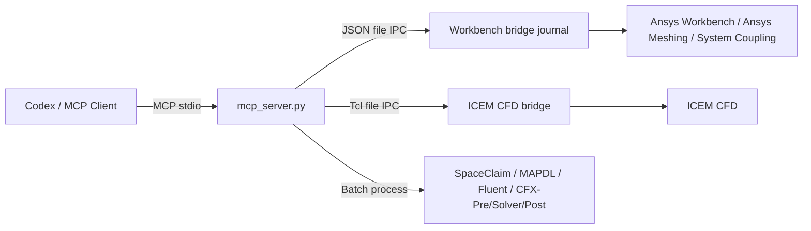

# Ansys Workbench MCP

<div align="center">

[English](README.en.md) | [简体中文](README.md) | [繁體中文](README.zh-TW.md) | **한국어** | [日本語](README.ja.md)

</div>


Codex 또는 다른 MCP 클라이언트에서 **SpaceClaim, Ansys Workbench, Ansys Meshing, System Coupling, ICEM CFD, MAPDL, Fluent, CFX-Pre, CFX Solver 및 CFD-Post**를 직접 제어합니다.

이 프로젝트는 마우스 클릭이나 화면 인식에 의존하지 않고 Ansys가 공식 지원하는 Journal, Workbench Scripting, Tcl/Replay 및 배치 실행 인터페이스를 사용합니다.

> [!NOTE]
> 이 프로젝트는 Ansys 공식 제품이 아닙니다. 현재 Windows를 대상으로 하며 Ansys 2025 R1 실제 설치 환경에서 검증되었습니다.

## 지원하는 시뮬레이션

| 해석 유형 | 솔버 | 실기 검증 범위 |
| --- | --- | --- |
| 정적·비선형 구조 해석 | Mechanical APDL | 선형 정적 해석, 무마찰 접촉, 이선형 소성 |
| 구조 동역학 | Mechanical APDL | 모드, 예응력 모드, 조화 응답, 과도 응답, 응답 스펙트럼, 랜덤 진동 |
| 열 해석 | Mechanical, Mechanical APDL | 정상 열전도 및 과도 가열 |
| 열–구조 연성 | Mechanical APDL | 온도장을 구조 모델로 전달하여 열팽창 계산 |
| 유동 해석 | Fluent, CFX | 유로 유동, 정적 혼합, 공동현상 |
| 복합 열전달 | Fluent | 유체 및 고체 온도장과 경계면 열유량 검증 |
| 양방향 유체–구조 연성 | System Coupling, Fluent, Mechanical APDL | 유체력과 구조 변위를 교환. CFX–Mechanical Workbench 경로는 시스템 연결을 검증 |

## 실기 검증 예제

**비선형 접촉 해석 · 축 방향 변위**



**정상 열전도 해석 · 온도**



**Fluent 공동현상 해석 · 증기 체적분율**



## 동작 방식



Workbench와 ICEM의 명령, 결과 및 로그는 런타임 디렉터리에 기록됩니다. 이 디렉터리는 자동으로 생성되며 `.gitignore`에서 제외됩니다.

## 빠른 시작

### 1. 설치

```powershell
cd D:\
git clone https://github.com/hongwenwang36-eng/ANSYS-Workbench-mcp.git ansys-workbench-mcp
cd D:\ansys-workbench-mcp
py -3.13 -m venv .venv
.\.venv\Scripts\python.exe -m pip install -r requirements.txt
```

Python 3.13이 없다면 `py -0p`로 설치된 버전을 확인한 뒤 위 버전 번호를 바꾸십시오.

### 2. Codex 설정

`%USERPROFILE%\.codex\config.toml`에 다음 내용을 추가합니다.

```toml
[mcp_servers.ansys-workbench]
command = 'D:\ansys-workbench-mcp\.venv\Scripts\python.exe'
args = ['D:\ansys-workbench-mcp\mcp_server.py']
cwd = 'D:\ansys-workbench-mcp'
startup_timeout_sec = 30
tool_timeout_sec = 600
enabled = true

[mcp_servers.ansys-workbench.env]
ANSYS_WORKBENCH_MCP_HOME = 'D:\ansys-workbench-mcp'
ANSYS_RUNWB2 = 'D:\Program Files\ANSYS Inc\v251\Framework\bin\Win64\RunWB2.exe'
ANSYS_MECHANICAL = 'D:\Program Files\ANSYS Inc\v251\aisol\bin\winx64\AnsysWBU.exe'
ANSYS_MAPDL = 'D:\Program Files\ANSYS Inc\v251\ansys\bin\winx64\ANSYS251.exe'
ANSYS_FLUENT = 'D:\Program Files\ANSYS Inc\v251\fluent\ntbin\win64\fluent.exe'
ANSYS_SPACECLAIM = 'D:\Program Files\ANSYS Inc\v251\scdm\SpaceClaim.exe'
ANSYS_CFX_SOLVE = 'D:\Program Files\ANSYS Inc\v251\CFX\bin\cfx5solve.exe'
ANSYS_CFX_PRE = 'D:\Program Files\ANSYS Inc\v251\CFX\bin\cfx5pre.exe'
ANSYS_CFX_POST = 'D:\Program Files\ANSYS Inc\v251\CFX\bin\cfx5post.exe'
ANSYS_ICEM_CFD = 'D:\Program Files\ANSYS Inc\v251\icemcfd\win64_amd\bin\icemcfd.bat'
ANSYS_SYSTEM_COUPLING = 'D:\Program Files\ANSYS Inc\v251\SystemCoupling\bin\systemcoupling.bat'
```

Ansys 설치 위치가 다르면 해당 환경 변수를 수정하십시오. 저장 후 Codex를 다시 시작합니다.

### 3. 연결 확인

먼저 `check_ansys_installation`으로 실행 파일 경로를 확인합니다. 현재 Workbench 프로젝트를 조작하려면 bridge를 시작하고 연결을 확인합니다.

```text
start_workbench_bridge
check_workbench_connection
```

독립 Ansys Meshing과 솔버 배치 도구는 직접 호출할 수 있습니다.

## Skill 및 실기 검증 예제

프로젝트의 12개 Skill은 워크플로, 형상, 메시, 구조·동역학, 열 해석, CFD, 연성, 매개변수 연구, 진단, 검증 및 후처리를 다룹니다. [Skill 목록 및 실행 예제](docs/skills-and-validation.md)

[전체 실기 검증 기록](docs/validation-record.md) · [Ansys Meshing 및 ICEM 예제](examples/meshing/README.md)

## MCP 도구

<details>
<summary>57개 도구 모두 보기</summary>

| 도구 | 설명 |
| --- | --- |
| `check_ansys_installation` | Ansys 실행 파일 및 bridge 경로 확인 |
| `write_ansys_script` | 지원되는 Ansys 스크립트 파일을 안전하게 작성하며 기본적으로 덮어쓰기를 금지 |
| `check_icem_installation` | ICEM CFD 및 Tcl bridge 확인 |
| `start_icem_bridge` | ICEM CFD 상주 세션 시작 |
| `stop_icem_bridge` | ICEM CFD 상주 세션 종료 |
| `check_icem_connection` | ICEM bridge 연결 확인 |
| `execute_icem_script` | ICEM에서 Tcl/Replay 실행 |
| `get_icem_session_info` | ICEM 세션 정보 조회 |
| `list_icem_commands` | ICEM Tcl 명령 검색 |
| `run_icem_replay` | Replay 파일을 batch 모드로 실행 |
| `start_workbench_bridge` | Workbench bridge 시작 |
| `stop_workbench_bridge` | Workbench bridge 종료 |
| `check_workbench_connection` | Workbench 연결 확인 |
| `execute_workbench_script` | Workbench에서 스크립트 실행 |
| `get_project_info` | 현재 프로젝트 정보 조회 |
| `open_project` | `.wbpj` 프로젝트 열기 |
| `save_project` | 현재 프로젝트 저장 |
| `update_project` | 프로젝트 업데이트 |
| `probe_workbench_analysis_templates_live` | 사용 가능한 해석 템플릿 검색 |
| `probe_system_coupling_live` | System Coupling 템플릿 및 스크립팅 인터페이스 확인 |
| `create_cfx_mechanical_fsi_project_live` | CFX–Mechanical–System Coupling 프로젝트 생성 및 연결 |
| `connect_system_coupling_participants_live` | 기존 시스템을 연성 참여자로 연결 |
| `get_system_coupling_status_live` | 참여자, 영역, 변수, 전송 및 설정 조회 |
| `configure_system_coupling_settings_live` | 연성 시간 간격, 기간 및 반복 제어 설정 |
| `create_system_coupling_data_transfer_live` | 일반 데이터 전송 생성 |
| `configure_cfx_mechanical_two_way_fsi_live` | 양방향 FSI의 변위 및 힘 전송 생성 |
| `export_system_coupling_setup_live` | System Coupling `.sci` 설정 내보내기 |
| `run_system_coupling_solution_live` | 연성 Solution 업데이트 및 실행 |
| `create_workbench_analysis_system_live` | 일반 해석 시스템 생성 |
| `create_steady_state_thermal_system_live` | Steady-State Thermal 시스템 생성 |
| `create_transient_thermal_system_live` | Transient Thermal 시스템 생성 |
| `create_static_structural_system_live` | Static Structural 시스템 생성 |
| `create_transient_structural_system_live` | Transient Structural 시스템 생성 |
| `create_modal_analysis_system_live` | Modal 시스템 생성 |
| `create_harmonic_response_system_live` | Harmonic Response 시스템 생성 |
| `create_response_spectrum_system_live` | Response Spectrum 시스템 생성 |
| `create_random_vibration_system_live` | Random Vibration 시스템 생성 |
| `create_cfx_flow_system_live` | CFX 시스템 생성 |
| `create_fluent_flow_system_live` | Fluent 시스템 생성 시도 |
| `create_thermal_bar_demo_live` | 열 해석 데모 생성 및 실행 |
| `run_spaceclaim_script` | SpaceClaim Python을 batch 모드로 실행하고 형상 출력 검증 |
| `run_cfx_pre_session` | CFX-Pre session을 batch 모드로 실행하고 `.cfx/.def` 출력 검증 |
| `run_cfx_post_session` | CFD-Post `.cse`를 batch 모드로 실행하고 내보낸 파일 검증 |
| `generate_ansys_mesh` | 독립 Ansys Meshing 시스템에서 메시 생성 및 내보내기 |
| `run_workbench_journal` | Workbench journal을 batch 모드로 실행하고 로그 표시와 결과 파일을 선택적으로 검증 |
| `create_workbench_analysis_system` | 해석 시스템을 batch 모드로 생성 |
| `create_steady_state_thermal_system` | Steady-State Thermal 시스템을 batch 모드로 생성 |
| `run_system_coupling_script` | System Coupling Python batch |
| `start_ansys_job` | 백그라운드 작업 제출 |
| `get_ansys_job` | 작업 상태와 로그 조회 |
| `stop_ansys_job` | 지정 작업 중지 |
| `diagnose_ansys_log` | 로그 오류 진단 |
| `verify_simulation` | CSV 단위 및 허용 범위 검증 |
| `run_mapdl_input` | MAPDL 입력 파일 실행 |
| `run_fluent_journal` | Fluent journal 실행 |
| `run_cfx_solver` | CFX `.def` 파일 실행 |
| `create_and_run_thermal_bar_demo` | 열 해석 데모를 batch 모드로 실행 |

</details>

## MCP 리소스

| URI | 내용 |
| --- | --- |
| `ansys-workbench://status` | Workbench bridge 상태 |
| `ansys-workbench://installation` | Ansys 설치 경로 확인 결과 |
| `ansys-workbench://icem/status` | ICEM CFD bridge 상태 |

## 문제 해결

| 문제 | 해결 방법 |
| --- | --- |
| Codex에 도구가 표시되지 않음 | `config.toml` 경로를 확인하고 Codex를 다시 시작 |
| Ansys 경로가 존재하지 않음 | 해당 `ANSYS_*` 환경 변수 수정 |
| Workbench bridge 시간 초과 | `stop_workbench_bridge` 실행 후 다시 시작하고 `mcp.log` 확인 |
| ICEM bridge 시간 초과 | `start_icem_bridge(batch=true)`로 시작하고 `icem/icem_bridge.log` 확인 |
| Fluent 템플릿을 사용할 수 없음 | `run_fluent_journal`을 사용하거나 `template_name`으로 설치된 템플릿 지정 |

MCP 클라이언트를 사용할 수 없는 경우 저장소 루트에서 `.\.venv\Scripts\python.exe stop_mcp.py`를 실행하여 bridge 작업 디렉터리에 중지 신호를 기록할 수 있습니다.

## 개발 및 테스트

```powershell
.\.venv\Scripts\python.exe -m unittest discover -s tests -v
```

테스트는 README, 등록된 도구 57개, 리소스 3개, bridge 버전 일치, 안전한 스크립트 작성, CFX 전후처리 명령 및 ICEM IPC 동작을 확인합니다.

## 라이선스

[MIT](LICENSE)

## 이번 버전의 변경 사항

### 추가

- 형상, 메시, 해석, 검증 및 후처리를 다루는 ANSYS Skill 12개를 추가했습니다.
- `generate_ansys_mesh`로 형상에서 독립 Mesh 프로젝트를 생성하고 메시 설정을 적용하며 `.meshdat`를 내보낸 후 다시 열어 통계를 확인합니다.
- 백그라운드 작업 제출·조회·중지, 로그 진단, CSV 수치 검증, 독립 System Coupling 배치 실행을 추가했습니다. MCP 도구는 50개에서 57개로 늘었습니다.
- 구조·동역학, 열, 메시, Fluent, CFX 및 연성의 재실행 예제와 검증 기록을 추가했습니다.

### 변경 및 수정

- 배치 출력 검사에서 빈 파일을 실패로 처리합니다. 백그라운드 작업을 중지하면 해당 Windows 작업의 프로세스도 종료됩니다.
- Fluent 배치 이미지 출력, Mechanical 절점 CSV 내보내기 및 프로젝트를 다시 연 후의 이미지 갱신을 수정했습니다.
- 5개 언어의 README에서 지원 해석, 실기 등고선 그림 및 버전 변경 사항을 정리했습니다.
