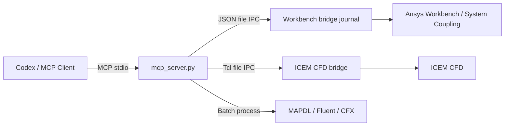

# Ansys Workbench MCP

<div align="center">

[English](README.en.md) | **简体中文** | [繁體中文](README.zh-TW.md) | [한국어](README.ko.md) | [日本語](README.ja.md)

</div>


让 Codex 或其他 MCP 客户端直接控制 **Ansys Workbench**。

项目使用 Ansys 官方支持的 Journal、Workbench Scripting、Tcl/Replay 和批处理入口，不依赖鼠标点击或屏幕识别。

> [!NOTE]
> 本项目不是 Ansys 官方产品。目前面向 Windows，并在 Ansys 2025 R1 上完成实机验证。

## 能做什么

| 模块 | 能力 |
| --- | --- |
| Workbench | 启停 bridge、执行脚本、读取/打开/保存/更新项目、创建分析系统 |
| ICEM CFD | 启动 GUI 或 batch 会话、执行 Tcl/Replay、查询命令、运行 Replay 文件 |
| Mechanical / MAPDL | 创建热/结构/动力学系统，直接运行 APDL 输入文件 |
| Fluent | 直接运行 journal/TUI；Workbench 模板存在时也可创建系统 |
| CFX | 创建 Workbench CFX 系统，直接运行 `.def` |
| System Coupling / FSI | 创建 CFX–Transient Structural 双向流固耦合工程、连接参与方、配置传递和求解控制、运行或导出 |

支持的 Workbench 系统：稳态热、瞬态热、静力、瞬态结构、模态、谐响应、响应谱、随机振动、CFX、System Coupling，以及安装中可用的 Fluent 模板。

## 工作原理



Workbench 和 ICEM 的命令、结果、日志都写入运行时目录；这些目录会自动创建并被 `.gitignore` 排除。

## 快速开始

### 1. 安装

```powershell
cd D:\
git clone https://github.com/hongwenwang36-eng/ANSYS-Workbench-mcp.git ansys-workbench-mcp
cd D:\ansys-workbench-mcp
py -3.13 -m venv .venv
.\.venv\Scripts\python.exe -m pip install -r requirements.txt
```

没有 Python 3.13 时，可用 `py -0p` 查看已安装版本，并替换上面的版本号。

### 2. 配置 Codex

在 `%USERPROFILE%\.codex\config.toml` 中加入：

```toml
[mcp_servers.ansys-workbench]
command = 'D:\ansys-workbench-mcp\.venv\Scripts\python.exe'
args = ['D:\ansys-workbench-mcp\mcp_server.py']
cwd = 'D:\ansys-workbench-mcp'
startup_timeout_sec = 30
tool_timeout_sec = 600
enabled = true

[mcp_servers.ansys-workbench.env]
ANSYS_WORKBENCH_MCP_HOME = 'D:\ansys-workbench-mcp'
ANSYS_RUNWB2 = 'D:\Program Files\ANSYS Inc\v251\Framework\bin\Win64\RunWB2.exe'
ANSYS_MECHANICAL = 'D:\Program Files\ANSYS Inc\v251\aisol\bin\winx64\AnsysWBU.exe'
ANSYS_MAPDL = 'D:\Program Files\ANSYS Inc\v251\ansys\bin\winx64\ANSYS251.exe'
ANSYS_FLUENT = 'D:\Program Files\ANSYS Inc\v251\fluent\ntbin\win64\fluent.exe'
ANSYS_CFX_SOLVE = 'D:\Program Files\ANSYS Inc\v251\CFX\bin\cfx5solve.exe'
ANSYS_CFX_PRE = 'D:\Program Files\ANSYS Inc\v251\CFX\bin\cfx5pre.exe'
ANSYS_ICEM_CFD = 'D:\Program Files\ANSYS Inc\v251\icemcfd\win64_amd\bin\icemcfd.bat'
```

如果安装位置不同，修改对应环境变量。保存后重启 Codex。

### 3. 检查连接

在 Codex 中依次调用：

```text
check_ansys_installation
start_workbench_bridge
check_workbench_connection
```

连接成功后即可让 Codex 创建系统、执行脚本或操作项目。

## 常用操作

### Workbench

```text
# 创建稳态热系统
create_steady_state_thermal_system_live(
  project_dir="D:/ansys-projects",
  project_name="thermal_case"
)

# 创建 CFX 系统
create_cfx_flow_system_live(
  project_dir="D:/ansys-projects",
  project_name="cfx_case"
)

# 查看并保存当前项目
get_project_info
save_project
```

不需要常驻 bridge 的一次性任务可使用 `run_workbench_journal`、`create_workbench_analysis_system` 或 `create_and_run_thermal_bar_demo`。

### CFX–Mechanical 双向流固耦合

```text
# 1. 创建三个系统并连接两名参与方
create_cfx_mechanical_fsi_project_live(
  project_dir="D:/ansys-projects/fsi",
  project_name="cfx_mechanical_fsi"
)

# 2. 在 CFX 与 Mechanical 中完成网格、瞬态物理和耦合边界后，刷新 Setup
# 3. 查询实际发布的参与方、区域和变量名称
get_system_coupling_status_live

# 4. 设置耦合步长和迭代次数
configure_system_coupling_settings_live(
  step_size="0.001 [s]",
  end_time="0.1 [s]",
  minimum_iterations=1,
  maximum_iterations=10
)

# 5. 用上一步返回的精确名称建立双向传递
configure_cfx_mechanical_two_way_fsi_live(...)

# 6. 验证后求解
run_system_coupling_solution_live
```

双向 FSI 包含两条传递：Mechanical 位移 → CFX 网格位移，以及 CFX 流体力 → Mechanical 载荷。工程创建工具不会虚构网格、材料、边界或接口区域；这些物理输入必须由实际模型提供。

### ICEM CFD

```text
# 启动无界面会话
start_icem_bridge(batch=true)

# 查询会话与 Blocking 命令
get_icem_session_info
list_icem_commands(pattern="ic_hex_*", limit=300)

# 执行 Tcl/Replay
execute_icem_script(script="ic_load_tetin {D:/cases/model.tin}")

# 一次性运行 Replay 文件
run_icem_replay(
  replay_file="D:/cases/mesh.rpl",
  workdir="D:/cases"
)
```

推荐先通过 ICEM Replay Control 录制可靠命令，再交给 MCP 参数化执行。

### 直接调用求解器

```text
run_mapdl_input(input_file="D:/cases/model.dat")
run_fluent_journal(journal_path="D:/cases/run.jou")
run_cfx_solver(definition_file="D:/cases/model.def")
```

## MCP 工具

<details>
<summary>展开全部 46 个工具</summary>

| 工具 | 说明 |
| --- | --- |
| `check_ansys_installation` | 检查 Ansys 程序和 bridge 路径 |
| `check_icem_installation` | 检查 ICEM CFD 和 Tcl bridge |
| `start_icem_bridge` | 启动 ICEM CFD 常驻会话 |
| `stop_icem_bridge` | 停止 ICEM CFD 常驻会话 |
| `check_icem_connection` | 检查 ICEM bridge 连接 |
| `execute_icem_script` | 在 ICEM 中执行 Tcl/Replay |
| `get_icem_session_info` | 查询 ICEM 会话信息 |
| `list_icem_commands` | 查询 ICEM Tcl 命令 |
| `run_icem_replay` | 批处理运行 Replay 文件 |
| `start_workbench_bridge` | 启动 Workbench bridge |
| `stop_workbench_bridge` | 停止 Workbench bridge |
| `check_workbench_connection` | 检查 Workbench 连接 |
| `execute_workbench_script` | 在 Workbench 中执行脚本 |
| `get_project_info` | 获取当前项目信息 |
| `open_project` | 打开 `.wbpj` 项目 |
| `save_project` | 保存当前项目 |
| `update_project` | 执行项目更新 |
| `probe_workbench_analysis_templates_live` | 探测可用分析模板 |
| `probe_system_coupling_live` | 探测 System Coupling 模板和脚本接口 |
| `create_cfx_mechanical_fsi_project_live` | 创建并连接 CFX–Mechanical–System Coupling 工程 |
| `connect_system_coupling_participants_live` | 把现有系统连接为耦合参与方 |
| `get_system_coupling_status_live` | 查询参与方、区域、变量、传递和设置 |
| `configure_system_coupling_settings_live` | 配置耦合步长、时长和迭代控制 |
| `create_system_coupling_data_transfer_live` | 创建通用数据传递 |
| `configure_cfx_mechanical_two_way_fsi_live` | 创建位移与力两条双向 FSI 传递 |
| `export_system_coupling_setup_live` | 导出 System Coupling `.sci` 设置 |
| `run_system_coupling_solution_live` | 更新并运行耦合 Solution |
| `create_workbench_analysis_system_live` | 创建通用分析系统 |
| `create_steady_state_thermal_system_live` | 创建稳态热系统 |
| `create_transient_thermal_system_live` | 创建瞬态热系统 |
| `create_static_structural_system_live` | 创建静力结构系统 |
| `create_transient_structural_system_live` | 创建瞬态结构系统 |
| `create_modal_analysis_system_live` | 创建模态系统 |
| `create_harmonic_response_system_live` | 创建谐响应系统 |
| `create_response_spectrum_system_live` | 创建响应谱系统 |
| `create_random_vibration_system_live` | 创建随机振动系统 |
| `create_cfx_flow_system_live` | 创建 CFX 系统 |
| `create_fluent_flow_system_live` | 尝试创建 Fluent 系统 |
| `create_thermal_bar_demo_live` | 创建并求解热分析示例 |
| `run_workbench_journal` | 批处理运行 Workbench journal |
| `create_workbench_analysis_system` | 批处理创建分析系统 |
| `create_steady_state_thermal_system` | 批处理创建稳态热系统 |
| `run_mapdl_input` | 运行 MAPDL 输入文件 |
| `run_fluent_journal` | 运行 Fluent journal |
| `run_cfx_solver` | 运行 CFX `.def` |
| `create_and_run_thermal_bar_demo` | 批处理运行热分析示例 |

</details>

## MCP 资源

| URI | 内容 |
| --- | --- |
| `ansys-workbench://status` | Workbench bridge 状态 |
| `ansys-workbench://installation` | Ansys 安装路径检查结果 |
| `ansys-workbench://icem/status` | ICEM CFD bridge 状态 |

## 验证状态

以下项目已在 Ansys 2025 R1 上实机通过：

- 46 个 MCP 工具和 3 个资源注册
- Workbench bridge 启停、脚本执行、项目读取/打开/保存/更新
- 稳态热、瞬态热、静力、瞬态结构、模态、谐响应、响应谱、随机振动和 CFX 系统创建
- System Coupling 模板、CFX/Transient Structural 参与方连接，以及三系统 FSI 工程保存
- Workbench 与 MAPDL 热分析求解：525 个节点，20–100 °C，0 个 MAPDL 错误
- Fluent `3ddp` journal 无界面运行
- ICEM CFD bridge、Tcl/Replay、命令发现和 batch 模式

当前边界：

- 本机 Workbench 未发现常见 Fluent 模板；`run_fluent_journal` 已验证可用。
- `run_cfx_solver` 已完成路径和调用逻辑检查，完整求解仍需要用户提供有效 `.def`。
- 双向数据传递与耦合求解需要实际 CFX/Mechanical 网格、System Coupling 区域和变量；空工程只验证系统拓扑，不能代替物理算例。

## 故障排查

| 问题 | 处理 |
| --- | --- |
| Codex 看不到工具 | 检查 `config.toml` 路径并重启 Codex |
| Ansys 路径不存在 | 修改相应的 `ANSYS_*` 环境变量 |
| Workbench bridge 超时 | 先 `stop_workbench_bridge`，再重新启动；查看 `mcp.log` |
| ICEM bridge 超时 | 先用 `start_icem_bridge(batch=true)`；查看 `icem/icem_bridge.log` |
| Fluent 模板不可用 | 使用 `run_fluent_journal`，或用 `template_name` 指定本机模板 |

## 开发与测试

```powershell
.\.venv\Scripts\python.exe -m unittest discover -s tests -v
```

测试会核对 README、46 个注册工具、3 个资源、bridge 版本以及 ICEM IPC 行为。

## License

[MIT](LICENSE)
