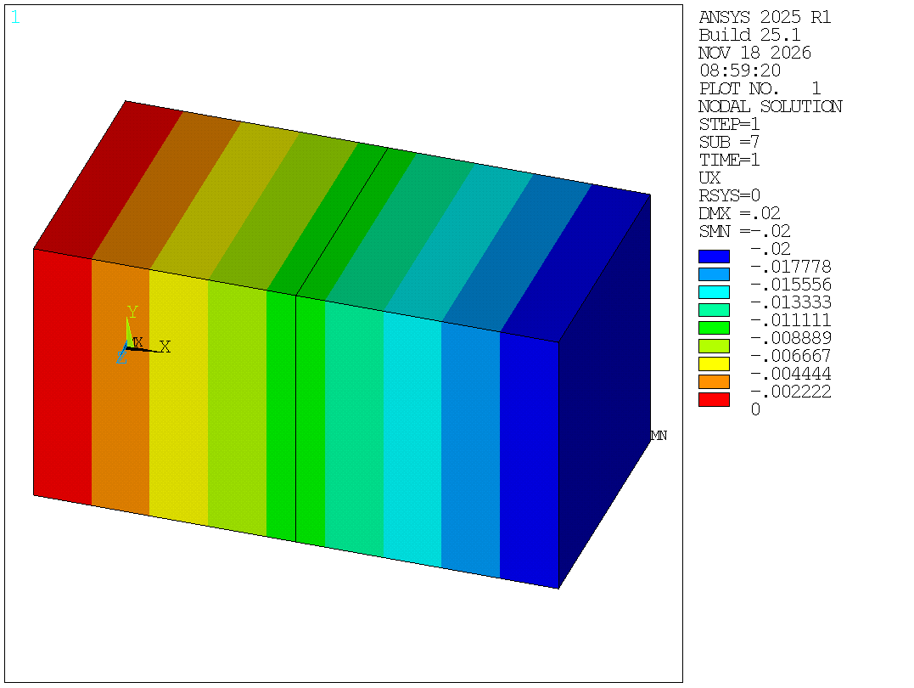
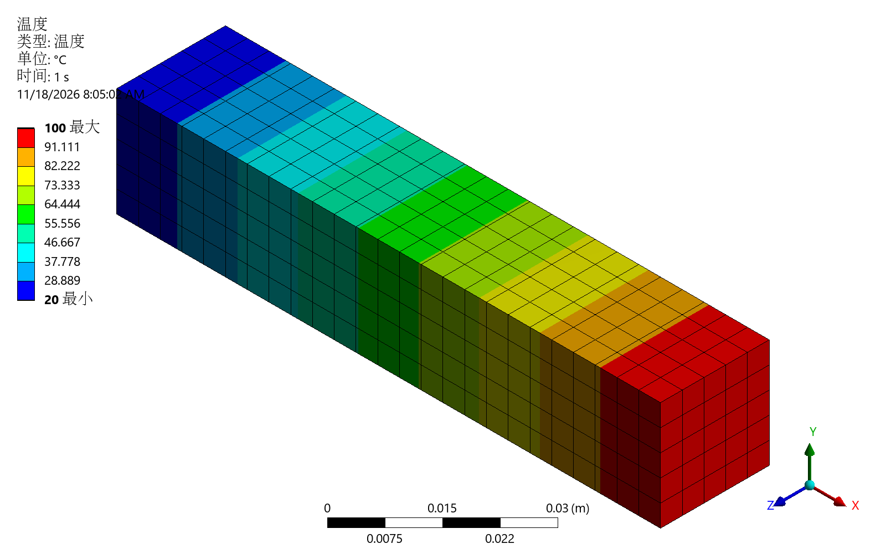
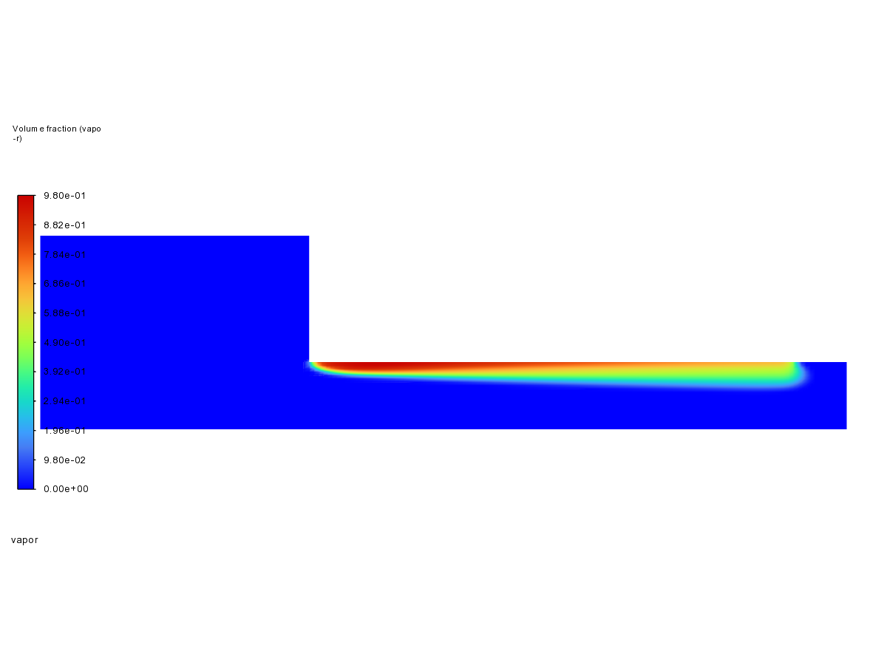
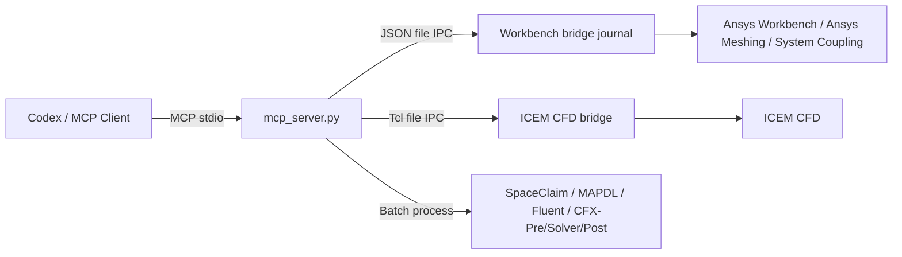

# Ansys Workbench MCP

<div align="center">

[English](README.en.md) | **简体中文** | [繁體中文](README.zh-TW.md) | [한국어](README.ko.md) | [日本語](README.ja.md)

</div>


让 Codex 或其他 MCP 客户端直接控制 **SpaceClaim、Ansys Workbench、Ansys Meshing、System Coupling、ICEM CFD、MAPDL、Fluent、CFX-Pre、CFX Solver 和 CFD-Post**。

项目使用 Ansys 官方支持的 Journal、Workbench Scripting、Tcl/Replay 和批处理入口，不依赖鼠标点击或屏幕识别。

> [!NOTE]
> 本项目不是 Ansys 官方产品。目前面向 Windows，并在 Ansys 2025 R1 上完成实机验证。

## 可实现的仿真

| 仿真类型 | 求解器 | 已实测的范围 |
| --- | --- | --- |
| 结构静力与非线性 | Mechanical APDL | 线性静力、无摩擦接触、双线性塑性 |
| 结构动力学 | Mechanical APDL | 模态、预应力模态、谐响应、瞬态、响应谱、随机振动 |
| 热分析 | Mechanical、Mechanical APDL | 稳态导热、瞬态加热 |
| 热–结构耦合 | Mechanical APDL | 将温度场传给结构模型，计算热膨胀 |
| 流体仿真 | Fluent、CFX | 流道流动、静态混合、空化 |
| 共轭传热 | Fluent | 求解流体与固体温度场，核对界面热流 |
| 双向流固耦合 | System Coupling、Fluent、Mechanical APDL | 交换流体力与结构位移。CFX–Mechanical 的 Workbench 路线已验证系统拓扑 |

## 实测案例

**非线性接触仿真 · 轴向位移**



**稳态导热仿真 · 温度**



**Fluent 空化仿真 · 汽相体积分数**



## 工作原理



Workbench 和 ICEM 的命令、结果、日志都写入运行时目录；这些目录会自动创建并被 `.gitignore` 排除。

## 快速开始

### 1. 安装

```powershell
cd D:\
git clone https://github.com/hongwenwang36-eng/ANSYS-Workbench-mcp.git ansys-workbench-mcp
cd D:\ansys-workbench-mcp
py -3.13 -m venv .venv
.\.venv\Scripts\python.exe -m pip install -r requirements.txt
```

没有 Python 3.13 时，可用 `py -0p` 查看已安装版本，并替换上面的版本号。

### 2. 配置 Codex

在 `%USERPROFILE%\.codex\config.toml` 中加入：

```toml
[mcp_servers.ansys-workbench]
command = 'D:\ansys-workbench-mcp\.venv\Scripts\python.exe'
args = ['D:\ansys-workbench-mcp\mcp_server.py']
cwd = 'D:\ansys-workbench-mcp'
startup_timeout_sec = 30
tool_timeout_sec = 600
enabled = true

[mcp_servers.ansys-workbench.env]
ANSYS_WORKBENCH_MCP_HOME = 'D:\ansys-workbench-mcp'
ANSYS_RUNWB2 = 'D:\Program Files\ANSYS Inc\v251\Framework\bin\Win64\RunWB2.exe'
ANSYS_MECHANICAL = 'D:\Program Files\ANSYS Inc\v251\aisol\bin\winx64\AnsysWBU.exe'
ANSYS_MAPDL = 'D:\Program Files\ANSYS Inc\v251\ansys\bin\winx64\ANSYS251.exe'
ANSYS_FLUENT = 'D:\Program Files\ANSYS Inc\v251\fluent\ntbin\win64\fluent.exe'
ANSYS_SPACECLAIM = 'D:\Program Files\ANSYS Inc\v251\scdm\SpaceClaim.exe'
ANSYS_CFX_SOLVE = 'D:\Program Files\ANSYS Inc\v251\CFX\bin\cfx5solve.exe'
ANSYS_CFX_PRE = 'D:\Program Files\ANSYS Inc\v251\CFX\bin\cfx5pre.exe'
ANSYS_CFX_POST = 'D:\Program Files\ANSYS Inc\v251\CFX\bin\cfx5post.exe'
ANSYS_ICEM_CFD = 'D:\Program Files\ANSYS Inc\v251\icemcfd\win64_amd\bin\icemcfd.bat'
ANSYS_SYSTEM_COUPLING = 'D:\Program Files\ANSYS Inc\v251\SystemCoupling\bin\systemcoupling.bat'
```

如果安装位置不同，修改对应环境变量。保存后重启 Codex。

### 3. 检查连接

先调用 `check_ansys_installation` 检查 Ansys 程序路径。操作当前 Workbench 工程时再启动并检查常驻桥接。

```text
start_workbench_bridge
check_workbench_connection
```

独立 Ansys Meshing 和求解器批处理可以直接调用。

## 专业 Skill 与实机基准

12 个项目级 Skill 覆盖工作流、几何、网格、结构、动力学、热、CFD、耦合、参数研究、诊断、验证和后处理。[Skill 清单与复跑方法](docs/skills-and-validation.md)

[完整实机验证记录](docs/validation-record.md) · [Ansys Meshing 与 ICEM 示例](examples/meshing/README.md)

## MCP 工具

<details>
<summary>展开全部 57 个工具</summary>

| 工具 | 说明 |
| --- | --- |
| `check_ansys_installation` | 检查 Ansys 程序和 bridge 路径 |
| `write_ansys_script` | 安全写入受支持的 Ansys 脚本文件，默认禁止覆盖 |
| `check_icem_installation` | 检查 ICEM CFD 和 Tcl bridge |
| `start_icem_bridge` | 启动 ICEM CFD 常驻会话 |
| `stop_icem_bridge` | 停止 ICEM CFD 常驻会话 |
| `check_icem_connection` | 检查 ICEM bridge 连接 |
| `execute_icem_script` | 在 ICEM 中执行 Tcl/Replay |
| `get_icem_session_info` | 查询 ICEM 会话信息 |
| `list_icem_commands` | 查询 ICEM Tcl 命令 |
| `run_icem_replay` | 批处理运行 Replay 文件 |
| `start_workbench_bridge` | 启动 Workbench bridge |
| `stop_workbench_bridge` | 停止 Workbench bridge |
| `check_workbench_connection` | 检查 Workbench 连接 |
| `execute_workbench_script` | 在 Workbench 中执行脚本 |
| `get_project_info` | 获取当前项目信息 |
| `open_project` | 打开 `.wbpj` 项目 |
| `save_project` | 保存当前项目 |
| `update_project` | 执行项目更新 |
| `probe_workbench_analysis_templates_live` | 探测可用分析模板 |
| `probe_system_coupling_live` | 探测 System Coupling 模板和脚本接口 |
| `create_cfx_mechanical_fsi_project_live` | 创建并连接 CFX–Mechanical–System Coupling 工程 |
| `connect_system_coupling_participants_live` | 把现有系统连接为耦合参与方 |
| `get_system_coupling_status_live` | 查询参与方、区域、变量、传递和设置 |
| `configure_system_coupling_settings_live` | 配置耦合步长、时长和迭代控制 |
| `create_system_coupling_data_transfer_live` | 创建通用数据传递 |
| `configure_cfx_mechanical_two_way_fsi_live` | 创建位移与力两条双向 FSI 传递 |
| `export_system_coupling_setup_live` | 导出 System Coupling `.sci` 设置 |
| `run_system_coupling_solution_live` | 更新并运行耦合 Solution |
| `create_workbench_analysis_system_live` | 创建通用分析系统 |
| `create_steady_state_thermal_system_live` | 创建稳态热系统 |
| `create_transient_thermal_system_live` | 创建瞬态热系统 |
| `create_static_structural_system_live` | 创建静力结构系统 |
| `create_transient_structural_system_live` | 创建瞬态结构系统 |
| `create_modal_analysis_system_live` | 创建模态系统 |
| `create_harmonic_response_system_live` | 创建谐响应系统 |
| `create_response_spectrum_system_live` | 创建响应谱系统 |
| `create_random_vibration_system_live` | 创建随机振动系统 |
| `create_cfx_flow_system_live` | 创建 CFX 系统 |
| `create_fluent_flow_system_live` | 尝试创建 Fluent 系统 |
| `create_thermal_bar_demo_live` | 创建并求解热分析示例 |
| `run_spaceclaim_script` | 批处理运行 SpaceClaim Python 并验证几何输出 |
| `run_cfx_pre_session` | 批处理运行 CFX-Pre session 并验证 `.cfx/.def` 输出 |
| `run_cfx_post_session` | 批处理运行 CFD-Post `.cse` 并验证导出文件 |
| `generate_ansys_mesh` | 从几何创建独立 Ansys Meshing 工程、划分并导出网格 |
| `run_workbench_journal` | 批处理运行 Workbench journal，可验证日志标志和结果文件 |
| `create_workbench_analysis_system` | 批处理创建分析系统 |
| `create_steady_state_thermal_system` | 批处理创建稳态热系统 |
| `run_system_coupling_script` | System Coupling Python batch |
| `start_ansys_job` | 后台提交批处理，支持请求去重 |
| `get_ansys_job` | 查询持久任务、结果及日志 |
| `stop_ansys_job` | 停止指定后台进程树 |
| `diagnose_ansys_log` | 定位日志错误和行号 |
| `verify_simulation` | 按单位和阈值检查 CSV 指标 |
| `run_mapdl_input` | 运行 MAPDL 输入文件 |
| `run_fluent_journal` | 运行 Fluent journal |
| `run_cfx_solver` | 运行 CFX `.def` |
| `create_and_run_thermal_bar_demo` | 批处理运行热分析示例 |

</details>

## MCP 资源

| URI | 内容 |
| --- | --- |
| `ansys-workbench://status` | Workbench bridge 状态 |
| `ansys-workbench://installation` | Ansys 安装路径检查结果 |
| `ansys-workbench://icem/status` | ICEM CFD bridge 状态 |

## 故障排查

| 问题 | 处理 |
| --- | --- |
| Codex 看不到工具 | 检查 `config.toml` 路径并重启 Codex |
| Ansys 路径不存在 | 修改相应的 `ANSYS_*` 环境变量 |
| Workbench bridge 超时 | 先 `stop_workbench_bridge`，再重新启动；查看 `mcp.log` |
| ICEM bridge 超时 | 先用 `start_icem_bridge(batch=true)`；查看 `icem/icem_bridge.log` |
| Fluent 模板不可用 | 使用 `run_fluent_journal`，或用 `template_name` 指定本机模板 |

MCP 客户端不可用时，可在仓库根目录运行 `.\.venv\Scripts\python.exe stop_mcp.py`，向当前桥接工作目录写入停止信号。

## 开发与测试

```powershell
.\.venv\Scripts\python.exe -m unittest discover -s tests -v
```

测试会核对 README、57 个注册工具、3 个资源、bridge 版本、脚本安全写入、CFX 前后处理命令以及 ICEM IPC 行为。

## License

[MIT](LICENSE)

## 本版更新

### 新增

- 新增 12 个 ANSYS Skill，覆盖几何、网格、仿真、验证与后处理等环节。
- 新增 `generate_ansys_mesh`，从几何创建独立 Mesh 工程，设置网格控制，导出 `.meshdat` 并重开核对统计。
- 新增后台任务提交、查询与停止，增加日志诊断、CSV 数值验收和独立 System Coupling 批处理。MCP 工具从 50 个增至 57 个。
- 新增结构、动力学、热、网格、Fluent、CFX 和耦合的可复跑算例及验收记录。

### 修改与修复

- 加强批处理产物检查，零字节输出会被判为失败。停止后台任务时同步终止所属 Windows 作业进程。
- 修正 Fluent 批处理云图导出、Mechanical 节点 CSV 导出及重开后图片刷新。
- 重排五语 README，集中展示仿真能力、实测云图和版本更新。
