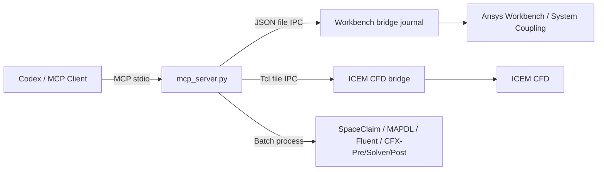

# Ansys Workbench MCP

<div align="center">

[English](README.en.md) | [简体中文](README.md) | **繁體中文** | [한국어](README.ko.md) | [日本語](README.ja.md)

</div>


讓 Codex 或其他 MCP 用戶端直接控制 **SpaceClaim、Ansys Workbench、System Coupling、ICEM CFD、MAPDL、Fluent、CFX-Pre、CFX Solver 與 CFD-Post**。

本專案使用 Ansys 官方支援的 Journal、Workbench Scripting、Tcl/Replay 和批次處理入口，不依賴滑鼠點擊或螢幕辨識。

> [!NOTE]
> 本專案不是 Ansys 官方產品。目前面向 Windows，並已在 Ansys 2025 R1 實機環境中完成驗證。

## 功能

| 模組 | 能力 |
| --- | --- |
| 腳本與 SpaceClaim | 安全寫入 `.wbjn/.py/.tcl/.rpl/.jou/.ccl/.pre/.cse`，並以批次模式執行 SpaceClaim Python |
| Workbench | 啟停 bridge、執行指令碼、讀取/開啟/儲存/更新專案、建立分析系統 |
| ICEM CFD | 啟動 GUI 或 batch 工作階段、執行 Tcl/Replay、查詢命令、執行 Replay 檔案 |
| Mechanical / MAPDL | 建立熱、結構與動力學系統，直接執行 APDL 輸入檔案 |
| Fluent | 直接執行 journal/TUI；Workbench 範本存在時亦可建立系統 |
| CFX | 批次執行 CFX-Pre session、CFX Solver `.def` 與 CFD-Post `.cse` |
| System Coupling / FSI | 建立 CFX–Transient Structural 雙向流固耦合專案、連接參與方、設定資料傳遞與求解控制、執行或匯出 |

支援的 Workbench 系統包括：穩態熱、暫態熱、靜力結構、暫態結構、模態、諧響應、響應譜、隨機振動、CFX、System Coupling，以及安裝中可用的 Fluent 範本。

## 運作方式



Workbench 和 ICEM 的命令、結果與日誌都會寫入執行階段目錄；這些目錄會自動建立，並由 `.gitignore` 排除。

## 快速開始

### 1. 安裝

```powershell
cd D:\
git clone https://github.com/hongwenwang36-eng/ANSYS-Workbench-mcp.git ansys-workbench-mcp
cd D:\ansys-workbench-mcp
py -3.13 -m venv .venv
.\.venv\Scripts\python.exe -m pip install -r requirements.txt
```

若未安裝 Python 3.13，可使用 `py -0p` 查看已安裝版本，並替換上述版本號。

### 2. 設定 Codex

在 `%USERPROFILE%\.codex\config.toml` 中加入：

```toml
[mcp_servers.ansys-workbench]
command = 'D:\ansys-workbench-mcp\.venv\Scripts\python.exe'
args = ['D:\ansys-workbench-mcp\mcp_server.py']
cwd = 'D:\ansys-workbench-mcp'
startup_timeout_sec = 30
tool_timeout_sec = 600
enabled = true

[mcp_servers.ansys-workbench.env]
ANSYS_WORKBENCH_MCP_HOME = 'D:\ansys-workbench-mcp'
ANSYS_RUNWB2 = 'D:\Program Files\ANSYS Inc\v251\Framework\bin\Win64\RunWB2.exe'
ANSYS_MECHANICAL = 'D:\Program Files\ANSYS Inc\v251\aisol\bin\winx64\AnsysWBU.exe'
ANSYS_MAPDL = 'D:\Program Files\ANSYS Inc\v251\ansys\bin\winx64\ANSYS251.exe'
ANSYS_FLUENT = 'D:\Program Files\ANSYS Inc\v251\fluent\ntbin\win64\fluent.exe'
ANSYS_SPACECLAIM = 'D:\Program Files\ANSYS Inc\v251\scdm\SpaceClaim.exe'
ANSYS_CFX_SOLVE = 'D:\Program Files\ANSYS Inc\v251\CFX\bin\cfx5solve.exe'
ANSYS_CFX_PRE = 'D:\Program Files\ANSYS Inc\v251\CFX\bin\cfx5pre.exe'
ANSYS_CFX_POST = 'D:\Program Files\ANSYS Inc\v251\CFX\bin\cfx5post.exe'
ANSYS_ICEM_CFD = 'D:\Program Files\ANSYS Inc\v251\icemcfd\win64_amd\bin\icemcfd.bat'
```

若安裝位置不同，請修改對應的環境變數。儲存後重新啟動 Codex。

### 3. 檢查連線

在 Codex 中依序呼叫：

```text
check_ansys_installation
start_workbench_bridge
check_workbench_connection
```

連線成功後，即可讓 Codex 建立系統、執行指令碼或操作專案。

## 常用操作

### Workbench

```text
# 建立穩態熱系統
create_steady_state_thermal_system_live(
  project_dir="D:/ansys-projects",
  project_name="thermal_case"
)

# 建立 CFX 系統
create_cfx_flow_system_live(
  project_dir="D:/ansys-projects",
  project_name="cfx_case"
)

# 查看並儲存目前專案
get_project_info
save_project
```

不需要常駐 bridge 的一次性工作，可使用 `run_workbench_journal`、`create_workbench_analysis_system` 或 `create_and_run_thermal_bar_demo`。

### CFX 幾何到平衡位置的完整流程

新的執行工具涵蓋幾何到平衡迭代：以 `write_ansys_script` 搭配 `run_spaceclaim_script` 建立幾何，使用 ICEM bridge 或 Replay 產生網格，以 `run_cfx_pre_session` 產生設定與 `.def`，用 `run_cfx_solver` 求解，再用 `run_cfx_post_session` 匯出承載力、力矩與場資料；外層可由 `run_workbench_journal` 更新參數並執行 Newton-Raphson 或阻尼迭代。輸出與日誌的新鮮度檢查可避免把舊檔誤判為本次迭代成功。

### CFX–Mechanical 雙向流固耦合

```text
# 1. 建立三個系統並連接兩個參與方
create_cfx_mechanical_fsi_project_live(
  project_dir="D:/ansys-projects/fsi",
  project_name="cfx_mechanical_fsi"
)

# 2. 在 CFX 與 Mechanical 中完成網格、暫態物理與耦合邊界後，重新整理 Setup
# 3. 查詢實際發佈的參與方、區域與變數名稱
get_system_coupling_status_live

# 4. 設定耦合步長與迭代次數
configure_system_coupling_settings_live(
  step_size="0.001 [s]",
  end_time="0.1 [s]",
  minimum_iterations=1,
  maximum_iterations=10
)

# 5. 使用上一步傳回的精確名稱建立雙向傳遞
configure_cfx_mechanical_two_way_fsi_live(...)

# 6. 驗證後求解
run_system_coupling_solution_live
```

雙向 FSI 包含兩條傳遞：Mechanical 位移 → CFX 網格位移，以及 CFX 流體力 → Mechanical 載荷。專案建立工具不會虛構網格、材料、邊界或介面區域；這些物理輸入必須由實際模型提供。

### ICEM CFD

```text
# 啟動無介面工作階段
start_icem_bridge(batch=true)

# 查詢工作階段與 Blocking 命令
get_icem_session_info
list_icem_commands(pattern="ic_hex_*", limit=300)

# 執行 Tcl/Replay
execute_icem_script(script="ic_load_tetin {D:/cases/model.tin}")

# 單次執行 Replay 檔案
run_icem_replay(
  replay_file="D:/cases/mesh.rpl",
  workdir="D:/cases"
)
```

建議先透過 ICEM Replay Control 錄製可靠命令，再交由 MCP 參數化執行。

### 直接呼叫求解器

```text
run_mapdl_input(input_file="D:/cases/model.dat")
run_fluent_journal(journal_path="D:/cases/run.jou")
run_cfx_pre_session(session_file="D:/cases/setup.pre", expected_output="D:/cases/model.def")
run_cfx_solver(definition_file="D:/cases/model.def")
run_cfx_post_session(session_file="D:/cases/export.cse", result_file="D:/cases/model.res")
```

## MCP 工具

<details>
<summary>展開全部 50 個工具</summary>

| 工具 | 說明 |
| --- | --- |
| `check_ansys_installation` | 檢查 Ansys 程式與 bridge 路徑 |
| `write_ansys_script` | 安全寫入支援的 Ansys 指令碼檔，預設禁止覆寫 |
| `check_icem_installation` | 檢查 ICEM CFD 與 Tcl bridge |
| `start_icem_bridge` | 啟動 ICEM CFD 常駐工作階段 |
| `stop_icem_bridge` | 停止 ICEM CFD 常駐工作階段 |
| `check_icem_connection` | 檢查 ICEM bridge 連線 |
| `execute_icem_script` | 在 ICEM 中執行 Tcl/Replay |
| `get_icem_session_info` | 查詢 ICEM 工作階段資訊 |
| `list_icem_commands` | 查詢 ICEM Tcl 命令 |
| `run_icem_replay` | 以批次模式執行 Replay 檔案 |
| `start_workbench_bridge` | 啟動 Workbench bridge |
| `stop_workbench_bridge` | 停止 Workbench bridge |
| `check_workbench_connection` | 檢查 Workbench 連線 |
| `execute_workbench_script` | 在 Workbench 中執行指令碼 |
| `get_project_info` | 取得目前專案資訊 |
| `open_project` | 開啟 `.wbpj` 專案 |
| `save_project` | 儲存目前專案 |
| `update_project` | 執行專案更新 |
| `probe_workbench_analysis_templates_live` | 探測可用分析範本 |
| `probe_system_coupling_live` | 探測 System Coupling 範本與指令碼介面 |
| `create_cfx_mechanical_fsi_project_live` | 建立並連接 CFX–Mechanical–System Coupling 專案 |
| `connect_system_coupling_participants_live` | 將現有系統連接為耦合參與方 |
| `get_system_coupling_status_live` | 查詢參與方、區域、變數、傳遞與設定 |
| `configure_system_coupling_settings_live` | 設定耦合步長、時長與迭代控制 |
| `create_system_coupling_data_transfer_live` | 建立通用資料傳遞 |
| `configure_cfx_mechanical_two_way_fsi_live` | 建立位移與力兩條雙向 FSI 傳遞 |
| `export_system_coupling_setup_live` | 匯出 System Coupling `.sci` 設定 |
| `run_system_coupling_solution_live` | 更新並執行耦合 Solution |
| `create_workbench_analysis_system_live` | 建立通用分析系統 |
| `create_steady_state_thermal_system_live` | 建立穩態熱系統 |
| `create_transient_thermal_system_live` | 建立暫態熱系統 |
| `create_static_structural_system_live` | 建立靜力結構系統 |
| `create_transient_structural_system_live` | 建立暫態結構系統 |
| `create_modal_analysis_system_live` | 建立模態系統 |
| `create_harmonic_response_system_live` | 建立諧響應系統 |
| `create_response_spectrum_system_live` | 建立響應譜系統 |
| `create_random_vibration_system_live` | 建立隨機振動系統 |
| `create_cfx_flow_system_live` | 建立 CFX 系統 |
| `create_fluent_flow_system_live` | 嘗試建立 Fluent 系統 |
| `create_thermal_bar_demo_live` | 建立並求解熱分析示例 |
| `run_spaceclaim_script` | 批次執行 SpaceClaim Python 並驗證幾何輸出 |
| `run_cfx_pre_session` | 批次執行 CFX-Pre session 並驗證 `.cfx/.def` 輸出 |
| `run_cfx_post_session` | 批次執行 CFD-Post `.cse` 並驗證匯出檔 |
| `run_workbench_journal` | 批次執行 Workbench journal，可驗證日誌標誌與結果檔 |
| `create_workbench_analysis_system` | 批次建立分析系統 |
| `create_steady_state_thermal_system` | 批次建立穩態熱系統 |
| `run_mapdl_input` | 執行 MAPDL 輸入檔案 |
| `run_fluent_journal` | 執行 Fluent journal |
| `run_cfx_solver` | 執行 CFX `.def` |
| `create_and_run_thermal_bar_demo` | 批次執行熱分析示例 |

</details>

## MCP 資源

| URI | 內容 |
| --- | --- |
| `ansys-workbench://status` | Workbench bridge 狀態 |
| `ansys-workbench://installation` | Ansys 安裝路徑檢查結果 |
| `ansys-workbench://icem/status` | ICEM CFD bridge 狀態 |

## 驗證狀態

以下項目已在 Ansys 2025 R1 上實機通過：

- 50 個 MCP 工具與 3 個資源註冊
- Workbench bridge 啟停、指令碼執行、專案讀取/開啟/儲存/更新
- 穩態熱、暫態熱、靜力結構、暫態結構、模態、諧響應、響應譜、隨機振動與 CFX 系統建立
- System Coupling 範本、CFX/Transient Structural 參與方連接，以及三系統 FSI 專案儲存
- Workbench 與 MAPDL 熱分析求解：525 個節點、20–100 °C、0 個 MAPDL 錯誤
- Fluent `3ddp` journal 無介面執行
- ICEM CFD bridge、Tcl/Replay、命令探索與 batch 模式
- SpaceClaim、CFX-Pre 與 CFD-Post 的批次入口及新輸出檢查
- CFD-Post `.cse` 已從真實 `.res` 匯出 PAD 壓力、座標與面連接資料

目前限制：

- 測試環境中的 Workbench 未找到常見 Fluent 範本；`run_fluent_journal` 已驗證可用。
- `run_cfx_solver` 已完成路徑與呼叫邏輯檢查，完整求解仍需使用者提供有效的 `.def`。
- MCP 提供完整執行鏈，但不會猜測幾何參數、邊界條件、收斂門檻或 Newton-Raphson Jacobian；必須由針對實際模型驗證的指令碼定義。
- 雙向資料傳遞與耦合求解需要實際 CFX/Mechanical 網格、System Coupling 區域與變數；空專案只能驗證系統拓撲，不能取代物理案例。

## 疑難排解

| 問題 | 處理方式 |
| --- | --- |
| Codex 看不到工具 | 檢查 `config.toml` 路徑並重新啟動 Codex |
| Ansys 路徑不存在 | 修改對應的 `ANSYS_*` 環境變數 |
| Workbench bridge 逾時 | 先執行 `stop_workbench_bridge`，再重新啟動；查看 `mcp.log` |
| ICEM bridge 逾時 | 先使用 `start_icem_bridge(batch=true)`；查看 `icem/icem_bridge.log` |
| Fluent 範本不可用 | 使用 `run_fluent_journal`，或以 `template_name` 指定本機範本 |

## 開發與測試

```powershell
.\.venv\Scripts\python.exe -m unittest discover -s tests -v
```

測試會核對 README、50 個註冊工具、3 個資源、bridge 版本、安全指令碼寫入、CFX 前後處理命令與 ICEM IPC 行為。

## 授權條款

[MIT](LICENSE)
