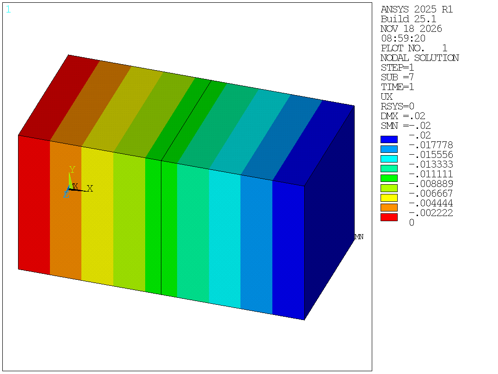
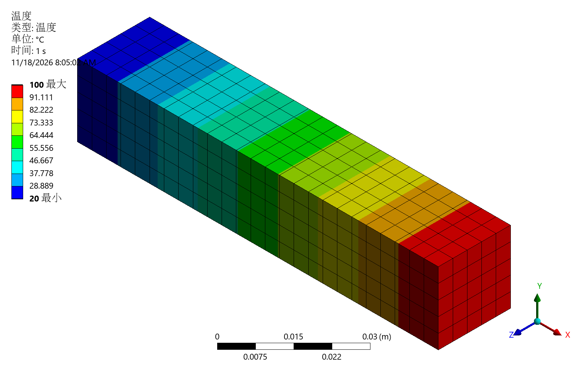
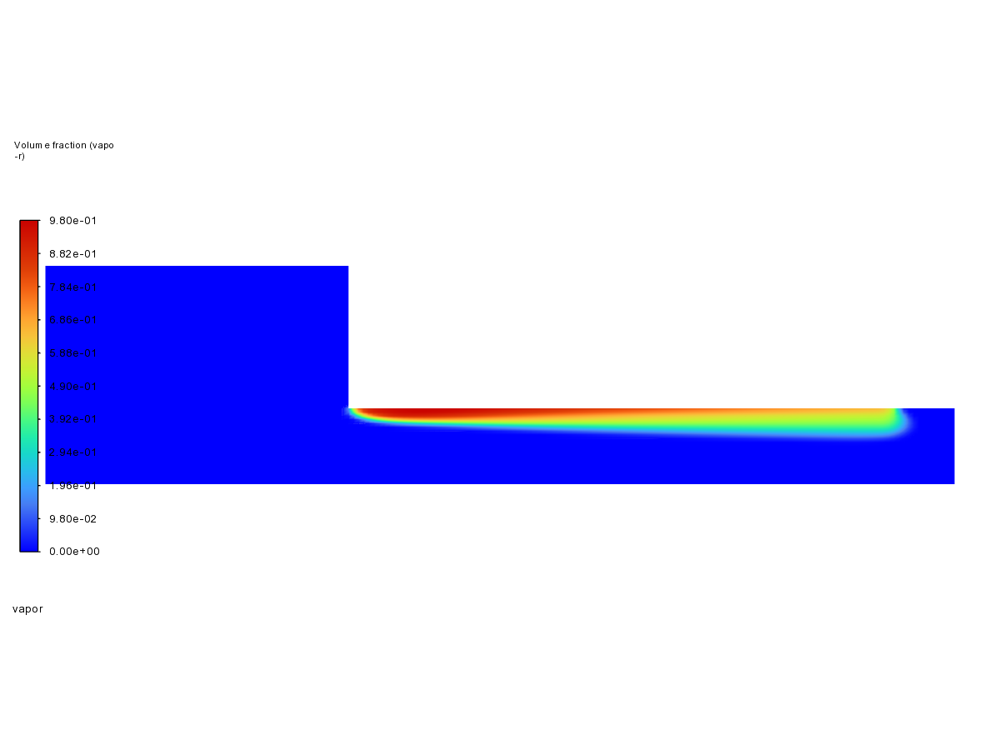
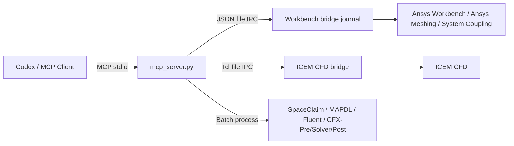

# Ansys Workbench MCP

<div align="center">

[English](README.en.md) | [简体中文](README.md) | **繁體中文** | [한국어](README.ko.md) | [日本語](README.ja.md)

</div>


讓 Codex 或其他 MCP 用戶端直接控制 **SpaceClaim、Ansys Workbench、Ansys Meshing、System Coupling、ICEM CFD、MAPDL、Fluent、CFX-Pre、CFX Solver 與 CFD-Post**。

本專案使用 Ansys 官方支援的 Journal、Workbench Scripting、Tcl/Replay 和批次處理入口，不依賴滑鼠點擊或螢幕辨識。

> [!NOTE]
> 本專案不是 Ansys 官方產品。目前面向 Windows，並已在 Ansys 2025 R1 實機環境中完成驗證。

## 可實現的模擬

| 模擬類型 | 求解器 | 已實測的範圍 |
| --- | --- | --- |
| 結構靜力與非線性 | Mechanical APDL | 線性靜力、無摩擦接觸、雙線性塑性 |
| 結構動力學 | Mechanical APDL | 模態、預應力模態、諧響應、暫態、響應譜、隨機振動 |
| 熱分析 | Mechanical、Mechanical APDL | 穩態導熱、暫態加熱 |
| 熱–結構耦合 | Mechanical APDL | 將溫度場傳給結構模型，計算熱膨脹 |
| 流體模擬 | Fluent、CFX | 流道流動、靜態混合、空化 |
| 共軛熱傳 | Fluent | 求解流體與固體溫度場，核對介面熱流 |
| 雙向流固耦合 | System Coupling、Fluent、Mechanical APDL | 交換流體力與結構位移。CFX–Mechanical 的 Workbench 路線已驗證系統拓樸 |

## 實測案例

**非線性接觸模擬 · 軸向位移**



**穩態導熱模擬 · 溫度**



**Fluent 空化模擬 · 蒸氣體積分率**



## 運作方式



Workbench 和 ICEM 的命令、結果與日誌都會寫入執行階段目錄；這些目錄會自動建立，並由 `.gitignore` 排除。

## 快速開始

### 1. 安裝

```powershell
cd D:\
git clone https://github.com/hongwenwang36-eng/ANSYS-Workbench-mcp.git ansys-workbench-mcp
cd D:\ansys-workbench-mcp
py -3.13 -m venv .venv
.\.venv\Scripts\python.exe -m pip install -r requirements.txt
```

若未安裝 Python 3.13，可使用 `py -0p` 查看已安裝版本，並替換上述版本號。

### 2. 設定 Codex

在 `%USERPROFILE%\.codex\config.toml` 中加入：

```toml
[mcp_servers.ansys-workbench]
command = 'D:\ansys-workbench-mcp\.venv\Scripts\python.exe'
args = ['D:\ansys-workbench-mcp\mcp_server.py']
cwd = 'D:\ansys-workbench-mcp'
startup_timeout_sec = 30
tool_timeout_sec = 600
enabled = true

[mcp_servers.ansys-workbench.env]
ANSYS_WORKBENCH_MCP_HOME = 'D:\ansys-workbench-mcp'
ANSYS_RUNWB2 = 'D:\Program Files\ANSYS Inc\v251\Framework\bin\Win64\RunWB2.exe'
ANSYS_MECHANICAL = 'D:\Program Files\ANSYS Inc\v251\aisol\bin\winx64\AnsysWBU.exe'
ANSYS_MAPDL = 'D:\Program Files\ANSYS Inc\v251\ansys\bin\winx64\ANSYS251.exe'
ANSYS_FLUENT = 'D:\Program Files\ANSYS Inc\v251\fluent\ntbin\win64\fluent.exe'
ANSYS_SPACECLAIM = 'D:\Program Files\ANSYS Inc\v251\scdm\SpaceClaim.exe'
ANSYS_CFX_SOLVE = 'D:\Program Files\ANSYS Inc\v251\CFX\bin\cfx5solve.exe'
ANSYS_CFX_PRE = 'D:\Program Files\ANSYS Inc\v251\CFX\bin\cfx5pre.exe'
ANSYS_CFX_POST = 'D:\Program Files\ANSYS Inc\v251\CFX\bin\cfx5post.exe'
ANSYS_ICEM_CFD = 'D:\Program Files\ANSYS Inc\v251\icemcfd\win64_amd\bin\icemcfd.bat'
ANSYS_SYSTEM_COUPLING = 'D:\Program Files\ANSYS Inc\v251\SystemCoupling\bin\systemcoupling.bat'
```

若安裝位置不同，請修改對應的環境變數。儲存後重新啟動 Codex。

### 3. 檢查連線

先呼叫 `check_ansys_installation` 檢查 Ansys 執行檔路徑。操作目前的 Workbench 專案時，再啟動並檢查 bridge。

```text
start_workbench_bridge
check_workbench_connection
```

獨立 Ansys Meshing 與求解器批次工具可直接呼叫。

## 專業 Skill 與實機案例

12 個專案級 Skill 涵蓋工作流程、幾何、網格、結構、動力學、熱分析、CFD、耦合、參數研究、診斷、驗證及後處理。[Skill 清單與復跑方式](docs/skills-and-validation.md)

[完整實機驗證紀錄](docs/validation-record.md) · [Ansys Meshing 與 ICEM 範例](examples/meshing/README.md)

## MCP 工具

<details>
<summary>展開全部 57 個工具</summary>

| 工具 | 說明 |
| --- | --- |
| `check_ansys_installation` | 檢查 Ansys 程式與 bridge 路徑 |
| `write_ansys_script` | 安全寫入支援的 Ansys 指令碼檔，預設禁止覆寫 |
| `check_icem_installation` | 檢查 ICEM CFD 與 Tcl bridge |
| `start_icem_bridge` | 啟動 ICEM CFD 常駐工作階段 |
| `stop_icem_bridge` | 停止 ICEM CFD 常駐工作階段 |
| `check_icem_connection` | 檢查 ICEM bridge 連線 |
| `execute_icem_script` | 在 ICEM 中執行 Tcl/Replay |
| `get_icem_session_info` | 查詢 ICEM 工作階段資訊 |
| `list_icem_commands` | 查詢 ICEM Tcl 命令 |
| `run_icem_replay` | 以批次模式執行 Replay 檔案 |
| `start_workbench_bridge` | 啟動 Workbench bridge |
| `stop_workbench_bridge` | 停止 Workbench bridge |
| `check_workbench_connection` | 檢查 Workbench 連線 |
| `execute_workbench_script` | 在 Workbench 中執行指令碼 |
| `get_project_info` | 取得目前專案資訊 |
| `open_project` | 開啟 `.wbpj` 專案 |
| `save_project` | 儲存目前專案 |
| `update_project` | 執行專案更新 |
| `probe_workbench_analysis_templates_live` | 探測可用分析範本 |
| `probe_system_coupling_live` | 探測 System Coupling 範本與指令碼介面 |
| `create_cfx_mechanical_fsi_project_live` | 建立並連接 CFX–Mechanical–System Coupling 專案 |
| `connect_system_coupling_participants_live` | 將現有系統連接為耦合參與方 |
| `get_system_coupling_status_live` | 查詢參與方、區域、變數、傳遞與設定 |
| `configure_system_coupling_settings_live` | 設定耦合步長、時長與迭代控制 |
| `create_system_coupling_data_transfer_live` | 建立通用資料傳遞 |
| `configure_cfx_mechanical_two_way_fsi_live` | 建立位移與力兩條雙向 FSI 傳遞 |
| `export_system_coupling_setup_live` | 匯出 System Coupling `.sci` 設定 |
| `run_system_coupling_solution_live` | 更新並執行耦合 Solution |
| `create_workbench_analysis_system_live` | 建立通用分析系統 |
| `create_steady_state_thermal_system_live` | 建立穩態熱系統 |
| `create_transient_thermal_system_live` | 建立暫態熱系統 |
| `create_static_structural_system_live` | 建立靜力結構系統 |
| `create_transient_structural_system_live` | 建立暫態結構系統 |
| `create_modal_analysis_system_live` | 建立模態系統 |
| `create_harmonic_response_system_live` | 建立諧響應系統 |
| `create_response_spectrum_system_live` | 建立響應譜系統 |
| `create_random_vibration_system_live` | 建立隨機振動系統 |
| `create_cfx_flow_system_live` | 建立 CFX 系統 |
| `create_fluent_flow_system_live` | 嘗試建立 Fluent 系統 |
| `create_thermal_bar_demo_live` | 建立並求解熱分析示例 |
| `run_spaceclaim_script` | 批次執行 SpaceClaim Python 並驗證幾何輸出 |
| `run_cfx_pre_session` | 批次執行 CFX-Pre session 並驗證 `.cfx/.def` 輸出 |
| `run_cfx_post_session` | 批次執行 CFD-Post `.cse` 並驗證匯出檔 |
| `generate_ansys_mesh` | 從幾何建立獨立 Ansys Meshing 專案、劃分並匯出網格 |
| `run_workbench_journal` | 批次執行 Workbench journal，可驗證日誌標誌與結果檔 |
| `create_workbench_analysis_system` | 批次建立分析系統 |
| `create_steady_state_thermal_system` | 批次建立穩態熱系統 |
| `run_system_coupling_script` | System Coupling Python batch |
| `start_ansys_job` | 提交背景批次工作 |
| `get_ansys_job` | 讀取工作狀態與日誌 |
| `stop_ansys_job` | 停止指定背景工作 |
| `diagnose_ansys_log` | 定位求解器錯誤 |
| `verify_simulation` | 依單位與範圍檢查 CSV 指標 |
| `run_mapdl_input` | 執行 MAPDL 輸入檔案 |
| `run_fluent_journal` | 執行 Fluent journal |
| `run_cfx_solver` | 執行 CFX `.def` |
| `create_and_run_thermal_bar_demo` | 批次執行熱分析示例 |

</details>

## MCP 資源

| URI | 內容 |
| --- | --- |
| `ansys-workbench://status` | Workbench bridge 狀態 |
| `ansys-workbench://installation` | Ansys 安裝路徑檢查結果 |
| `ansys-workbench://icem/status` | ICEM CFD bridge 狀態 |

## 疑難排解

| 問題 | 處理方式 |
| --- | --- |
| Codex 看不到工具 | 檢查 `config.toml` 路徑並重新啟動 Codex |
| Ansys 路徑不存在 | 修改對應的 `ANSYS_*` 環境變數 |
| Workbench bridge 逾時 | 先執行 `stop_workbench_bridge`，再重新啟動；查看 `mcp.log` |
| ICEM bridge 逾時 | 先使用 `start_icem_bridge(batch=true)`；查看 `icem/icem_bridge.log` |
| Fluent 範本不可用 | 使用 `run_fluent_journal`，或以 `template_name` 指定本機範本 |

MCP 用戶端不可用時，可在儲存庫根目錄執行 `.\.venv\Scripts\python.exe stop_mcp.py`，向 bridge 的工作目錄寫入停止訊號。

## 開發與測試

```powershell
.\.venv\Scripts\python.exe -m unittest discover -s tests -v
```

測試會核對 README、57 個註冊工具、3 個資源、bridge 版本、安全指令碼寫入、CFX 前後處理命令與 ICEM IPC 行為。

## 授權條款

[MIT](LICENSE)

## 本版更新

### 新增

- 新增 12 個 ANSYS Skill，涵蓋幾何、網格、模擬、驗證與後處理。
- 新增 `generate_ansys_mesh`，從幾何建立獨立 Mesh 專案，設定網格控制，匯出 `.meshdat` 並重新開啟核對統計。
- 新增背景工作提交、查詢與停止，以及日誌診斷、CSV 數值驗收和獨立 System Coupling 批次執行。MCP 工具由 50 個增至 57 個。
- 新增結構、動力學、熱、網格、Fluent、CFX 與耦合的可重跑案例及驗收紀錄。

### 修改與修復

- 強化批次產物檢查，零位元組輸出會判為失敗。停止背景工作時終止所屬 Windows 工作的程序。
- 修復 Fluent 批次圖檔匯出、Mechanical 節點 CSV 匯出及重新開啟專案後的圖片更新。
- 重整五語 README，集中呈現模擬能力、實測雲圖與版本更新。
